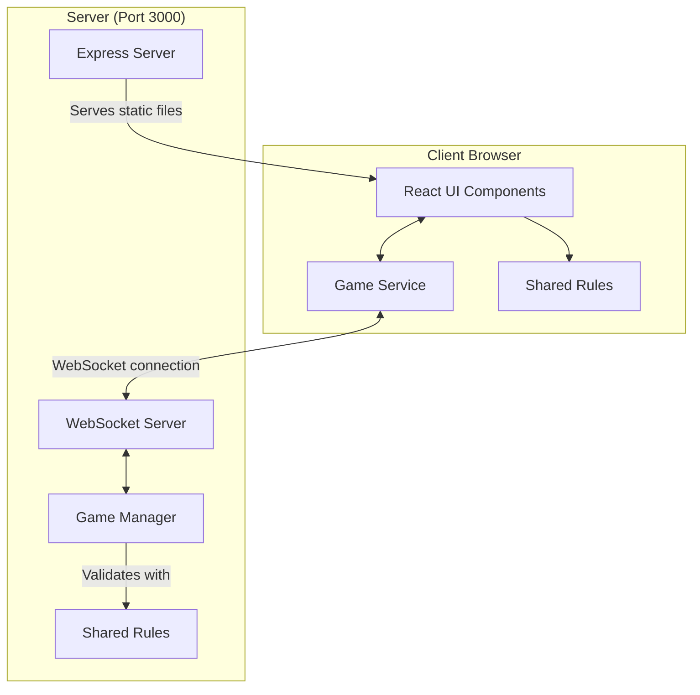

# Azul Multiplayer Architecture



## Client

1. **React UI components (`/src/components`)**

   - `Game.tsx` shows `JoinForm.tsx` until the player is seated, then `GameScreen.tsx`
   - `GameScreen.tsx` lays out the game and owns the selection: the tiles picked up but not yet placed
   - `GameStatus.tsx` shows the status line, whose turn it is, and a hint
   - `Factories.tsx` renders the factories and the centre and turns clicks into a selection
   - `PlayerBoard.tsx` renders one player's pattern lines, wall, floor line and score, and turns clicks into moves
   - `Tile.tsx` renders one tile or the first-player marker
   - `RoundSummary.tsx` shows why everyone scored what they did, with the Continue button
   - `UndoVote.tsx` shows a running undo vote
   - `Faq.tsx` is the rules and controls guide behind the FAQ button
   - `/src/hooks/useGameConnection.ts` holds the joined game's state and errors from the Game Service

2. **Game Service (`/src/services/gameService.ts`)**

   - Manages the WebSocket connection
   - Sends joins, moves, round acknowledgements, undo requests and undo votes
   - Passes server state updates and errors to the UI

3. **Shared Rules (`/shared/rules.ts`)**
   - The wall layout, legal pattern lines, placement scoring, floor penalties and end-game bonuses
   - The lobby, moves, the end of a round and the end of the game, as pure functions over immutable state
   - Used by the browser to outline legal lines, and by the server to validate every move
   - Data shapes live in `/shared/types.ts`; WebSocket message types live in `/shared/messages.ts`

## Server

1. **Express and WebSocket server (`/server/server.ts`)**

   - Serves the built React application and handles SPA routing
   - Routes WebSocket messages to the game manager and broadcasts the results

2. **Game Manager (`/server/games.ts`)**

   - Creates games, seats up to four players, and locks joining after the first move
   - Validates and applies moves with the shared rules
   - Holds the round summary until every player has acknowledged it, then deals the next round
   - Keeps each game's undo history and runs unanimous undo votes
   - Holds each game's full state in memory, and sends only the public view

## Hidden state

The full `GameState` includes the bag and the lid (the discard pile). `toPublicState` removes them, along with round bookkeeping, before anything is sent. Browsers receive `PublicGameState`: the factories, the centre, every board, and the scores. So nobody can count what is left in the bag, as in the physical game.

## Communication Flow

1. **Joining**

   ```
   Client -> Server: JOIN_GAME (gameId, playerName)
   Server -> Client: GAME_JOINED (playerNumber, gameState) or GAME_ERROR
   Server -> All clients in the game: GAME_STATE
   ```

2. **Playing**

   ```
   Client -> Server: MAKE_MOVE (source, color, line)
   Server -> All clients in the game: GAME_STATE, or GAME_ERROR to the sender
   ```

   The move that empties the table also scores the round, so the state that comes back carries a round summary, or the final result.

3. **Between rounds**

   ```
   Each client -> Server: ACKNOWLEDGE_ROUND
   Server -> All clients in the game: GAME_STATE (who is ready, then the next round once everyone is)
   ```

4. **Undo**

   ```
   Client -> Server: REQUEST_UNDO
   Each client -> Server: VOTE_UNDO (approve)
   Server -> All clients in the game: GAME_STATE (vote progress, then the restored state or the decline)
   ```

5. **Disconnecting**
   ```
   Client disconnects
   Server -> Remaining clients: GAME_STATE (player marked as left)
   ```

## Single Port

All communication happens over port 3000: HTTP serves the React application and WebSocket carries the game. With Docker, the server still listens on 3000 inside the container and `APP_PORT` picks the host port. The browser builds the WebSocket URL from the page address, so it follows whatever host port is mapped.
