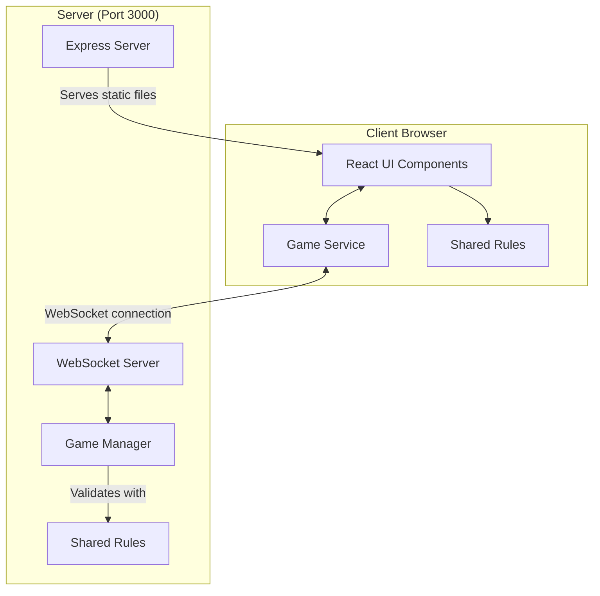

# Azul Implementation Plan

> **For agentic workers:** REQUIRED SUB-SKILL: Use superpowers:subagent-driven-development (recommended) or superpowers:executing-plans to implement this plan task-by-task. Steps use checkbox (`- [ ]`) syntax for tracking.

**Goal:** A real-time multiplayer Azul for two to four players, built and packaged the same way as the Quoridor project in `../quoridor`.

**Architecture:** Every rule is a pure function in `shared/rules.ts`, imported by both the React client (for hints) and the Node server (for validation). `server/games.ts` keeps games in memory and strips the bag and lid before anything is sent; `server/server.ts` is Express plus WebSocket plumbing on one port. The client renders the public state and sends one move per turn.

**Tech Stack:** React 19, Vite 6, TypeScript 5.9, Express 5, `ws` 8, Node 22.18+ running TypeScript directly, Node built-in test runner (`node:test`, `node:assert/strict`).

**Spec:** `docs/superpowers/specs/2026-10-11-azul-design.md`

## Global Constraints

- The project lives in `C:\Users\Natha\Documents\Code\node\azul`. Quoridor, the reference, is at `../quoridor`. Never modify anything under `../quoridor`.
- Work on branch `initial-game`. Never commit to `master`.
- Every commit message ends with the line `Co-Authored-By: Claude Opus 5.5 <noreply@anthropic.com>`.
- No em-dashes in any prose: docs, README, commit messages, UI strings.
- No npm dependencies beyond the ones in Task 1's `package.json` (the same set as Quoridor).
- Node 22.18 or newer. The server runs `.ts` files directly, so TypeScript must stay erasable: no enums, no parameter properties, no namespaces. Imports of local files use explicit `.ts` extensions.
- Colours, in this order: `blue`, `yellow`, `red`, `black`, `cyan`. 20 tiles each, 100 in total.
- Factories: 5 for two players, 7 for three, 9 for four. 4 tiles each.
- Floor penalties: 1, 1, 2, 2, 2, 3, 3 (7 slots).
- End-game bonuses: +2 per complete wall row, +7 per complete column, +10 per colour with all five tiles placed.
- Max 4 players, seats 1 to 4 in join order. No undo.
- The bag and the lid must never appear in anything the server sends.

## File Structure

| File | Responsibility |
|---|---|
| `package.json`, `tsconfig*.json`, `vite.config.ts`, `eslint.config.js`, `index.html`, `.nvmrc`, `.gitignore`, `.gitattributes` | Tooling, same as Quoridor |
| `shared/types.ts` | Data shapes used by browser and server |
| `shared/messages.ts` | WebSocket message names and shapes, `asRecord` |
| `shared/rules.ts` | Wall layout, legal lines, scoring, lobby, moves, round end, game end |
| `shared/rules.test.ts` | Unit tests for the rules |
| `server/games.ts` | Game registry: join, leave, move, public view |
| `server/games.test.ts` | Unit tests for the game manager |
| `server/server.ts` | Express static serving and WebSocket routing |
| `src/main.tsx`, `src/App.tsx`, `src/index.css`, `src/App.css` | App shell and styles |
| `src/selection.ts` | The client's "tiles picked up" selection type |
| `src/services/gameService.ts` | WebSocket client |
| `src/hooks/useGameConnection.ts` | Joined game state and errors for React |
| `src/components/Game.tsx`, `JoinForm.tsx`, `GameScreen.tsx`, `GameStatus.tsx`, `ThemeToggle.tsx` | Screens |
| `src/components/Factories.tsx`, `PlayerBoard.tsx`, `Tile.tsx` | The table and the boards |
| `Dockerfile`, `docker-compose.yml`, `.dockerignore`, `run.sh`, `run.ps1`, `run.conf`, `compose-launcher/` (submodule), `.github/workflows/ci.yml` | Packaging, same as Quoridor |
| `README.md`, `docs/architecture.md` | Docs |

---

### Task 1: Project scaffolding

**Files:**
- Create: `package.json`, `src/main.tsx`, `src/App.tsx`, `src/index.css`, `public/favicon.svg`, `index.html`
- Copy from `../quoridor`: `tsconfig.json`, `tsconfig.app.json`, `tsconfig.node.json`, `vite.config.ts`, `eslint.config.js`, `.nvmrc`, `.gitignore`, `.gitattributes`

**Interfaces:**
- Produces: working `npm run lint`, `npm run typecheck`, `npm run build`, `npm test` scripts.

- [ ] **Step 1: Create the branch and copy the tooling files**

```bash
cd /c/Users/Natha/Documents/Code/node/azul
git checkout -b initial-game
cp ../quoridor/tsconfig.json ../quoridor/tsconfig.app.json ../quoridor/tsconfig.node.json \
   ../quoridor/vite.config.ts ../quoridor/eslint.config.js \
   ../quoridor/.nvmrc ../quoridor/.gitignore ../quoridor/.gitattributes .
mkdir -p src public shared server
```

- [ ] **Step 2: Write `package.json`**

```json
{
  "name": "azul",
  "private": true,
  "version": "0.0.0",
  "type": "module",
  "engines": {
    "node": ">=22.18"
  },
  "scripts": {
    "dev": "vite",
    "typecheck": "tsc -b",
    "build": "npm run typecheck && vite build",
    "lint": "eslint . --report-unused-disable-directives --max-warnings 0",
    "preview": "vite preview",
    "start": "npm run build && node server/server.ts",
    "test": "node --test"
  },
  "dependencies": {
    "express": "^5.1.0",
    "react": "^19.0.0",
    "react-dom": "^19.0.0",
    "ws": "^8.18.1"
  },
  "devDependencies": {
    "@eslint/js": "^9.21.0",
    "@types/express": "^5.0.6",
    "@types/node": "^22.20.5",
    "@types/react": "^19.0.10",
    "@types/react-dom": "^19.0.4",
    "@types/ws": "^8.18.2",
    "@vitejs/plugin-react": "^4.3.4",
    "eslint": "^9.21.0",
    "eslint-plugin-react-hooks": "^5.1.0",
    "eslint-plugin-react-refresh": "^0.4.19",
    "globals": "^15.15.0",
    "typescript": "^5.9.3",
    "typescript-eslint": "^8.71.0",
    "vite": "^6.2.0"
  },
  "overrides": {
    "rollup": "4.63.0"
  }
}
```

- [ ] **Step 3: Write `index.html`**

```html
<!doctype html>
<html lang="en">
  <head>
    <meta charset="UTF-8" />
    <link rel="icon" type="image/svg+xml" href="/favicon.svg" />
    <meta name="viewport" content="width=device-width, initial-scale=1.0" />
    <title>Azul</title>
    <script>
      document.documentElement.setAttribute('data-theme', localStorage.getItem('theme') || 'light');
    </script>
  </head>
  <body>
    <div id="root"></div>
    <script type="module" src="/src/main.tsx"></script>
  </body>
</html>
```

- [ ] **Step 4: Write `public/favicon.svg`**

```svg
<svg xmlns="http://www.w3.org/2000/svg" viewBox="0 0 32 32">
  <rect x="2" y="2" width="28" height="28" rx="5" fill="#1e6fd9"/>
  <path d="M16 7 L25 16 L16 25 L7 16 Z" fill="#fff"/>
</svg>
```

- [ ] **Step 5: Write `src/main.tsx`, `src/App.tsx`, `src/index.css`**

`src/main.tsx`:

```tsx
import { StrictMode } from 'react'
import { createRoot } from 'react-dom/client'
import './index.css'
import App from './App.tsx'

// index.html always contains the #root element
createRoot(document.getElementById('root')!).render(
  <StrictMode>
    <App />
  </StrictMode>,
)
```

`src/App.tsx` (a placeholder until Task 6):

```tsx
function App() {
  return (
    <div className="app">
      <h1>Azul</h1>
    </div>
  )
}

export default App
```

`src/index.css`:

```css
:root {
  font-family: 'Segoe UI', system-ui, Avenir, Helvetica, Arial, sans-serif;
  line-height: 1.5;
  font-weight: 400;
  font-synthesis: none;
  text-rendering: optimizeLegibility;
  -webkit-font-smoothing: antialiased;
  -moz-osx-font-smoothing: grayscale;
}

body {
  margin: 0;
  min-width: 320px;
  min-height: 100vh;
}

button {
  font-family: inherit;
  font-size: 1em;
  cursor: pointer;
}
```

- [ ] **Step 6: Install and verify**

Run: `npm install`
Expected: finishes without errors and writes `package-lock.json`.

Run: `npm run lint && npm run build`
Expected: both succeed; `dist/index.html` exists.

- [ ] **Step 7: Commit**

```bash
git add package.json package-lock.json tsconfig.json tsconfig.app.json tsconfig.node.json \
  vite.config.ts eslint.config.js .nvmrc .gitignore .gitattributes index.html public src
git commit -m "Scaffold the Azul project

Co-Authored-By: Claude Opus 5.5 <noreply@anthropic.com>"
```

---

### Task 2: Shared types, wall layout, legal lines and scoring

**Files:**
- Create: `shared/types.ts`, `shared/messages.ts`, `shared/rules.ts`
- Test: `shared/rules.test.ts`

**Interfaces:**
- Produces, from `shared/types.ts`: `Seat`, `Color`, `FloorItem`, `PatternLine`, `PlayerBoard`, `Source`, `Move`, `LastMove`, `PublicGameState`, `GameState`, `Result<T>`.
- Produces, from `shared/messages.ts`: `MESSAGE_TYPES`, `ClientMessage`, `ServerMessage`, `asRecord(value: unknown): Record<string, unknown> | null`.
- Produces, from `shared/rules.ts`: `COLORS: Color[]`, `MAX_PLAYERS`, `LINE_COUNT`, `TILES_PER_COLOR`, `FACTORY_SIZE`, `FLOOR_PENALTIES: number[]`, `factoryCount(playerCount: number): number`, `wallColor(row: number, col: number): Color`, `wallColumn(row: number, color: Color): number`, `canPlaceOnLine(board: PlayerBoard, line: number, color: Color): boolean`, `legalLines(board: PlayerBoard, color: Color): number[]`, `sourceTiles(state: Pick<PublicGameState, 'factories' | 'center'>, source: Source): Color[]`, `sourceColors(state, source): Color[]`, `scorePlacement(wall: boolean[][], row: number, col: number): number`, `floorPenalty(floor: FloorItem[]): number`, `completeRows(wall: boolean[][]): number`, `endGameBonus(wall: boolean[][]): number`.

- [ ] **Step 1: Write `shared/types.ts`**

```ts
// Data shapes shared by the browser and the server

export type Seat = number; // A player number, 1 to 4

export type Color = 'blue' | 'yellow' | 'red' | 'black' | 'cyan';

// 'first' is the first-player marker
export type FloorItem = Color | 'first';

export type PatternLine = { color: Color | null; count: number };

export type PlayerBoard = {
  patternLines: PatternLine[]; // 5 lines; line i holds up to i + 1 tiles
  wall: boolean[][];           // 5x5, true where a tile is placed
  floor: FloorItem[];          // at most 7
  score: number;
};

export type Source = { type: 'factory'; index: number } | { type: 'center' };

export type Move = { source: Source; color: Color; line: number | 'floor' };

export type LastMove = Move & { playerNumber: Seat; count: number };

// The game state as the server sends it to browsers
export type PublicGameState = {
  gameId: string;
  started: boolean;
  round: number;
  currentPlayer: Seat | null;
  activePlayers: Seat[];
  playerNames: Record<Seat, string>;
  factories: Color[][];
  center: Color[];
  centerHasMarker: boolean;
  boards: Record<Seat, PlayerBoard>;
  lastMove: LastMove | null;
  gameStatus: string;
  isGameOver: boolean;
  winners: Seat[];
};

// The full state, which never leaves the server: nobody can count the bag
export type GameState = PublicGameState & {
  bag: Color[];
  lid: Color[];
  roundStarter: Seat | null;  // who took the first turn this round
  markerHolder: Seat | null;  // who took the first-player marker this round
};

export type Result<T> = { state: T } | { error: string };
```

- [ ] **Step 2: Write `shared/messages.ts`**

```ts
import type { Move, PublicGameState, Seat } from './types.ts';

// WebSocket message types shared by the browser and the server
export const MESSAGE_TYPES = {
  JOIN_GAME: 'JOIN_GAME',
  GAME_JOINED: 'GAME_JOINED',
  MAKE_MOVE: 'MAKE_MOVE',
  GAME_STATE: 'GAME_STATE',
  GAME_ERROR: 'GAME_ERROR'
} as const;

export type ClientMessage =
  | { type: typeof MESSAGE_TYPES.JOIN_GAME; gameId: string; playerName: string }
  | { type: typeof MESSAGE_TYPES.MAKE_MOVE; payload: { move: Move } };

export type ServerMessage =
  | { type: typeof MESSAGE_TYPES.GAME_JOINED; payload: { playerNumber: Seat; gameState: PublicGameState } }
  | { type: typeof MESSAGE_TYPES.GAME_STATE; payload: PublicGameState }
  | { type: typeof MESSAGE_TYPES.GAME_ERROR; payload: { message: string } };

// Reads untrusted data as an object whose fields are all still unchecked, or null if it is not an object
export function asRecord(value: unknown): Record<string, unknown> | null {
  // Any non-null object can be read field by field; each field stays `unknown`
  return typeof value === 'object' && value !== null ? (value as Record<string, unknown>) : null;
}
```

- [ ] **Step 3: Write the failing tests in `shared/rules.test.ts`**

```ts
import { test } from 'node:test';
import assert from 'node:assert/strict';
import {
  COLORS,
  factoryCount,
  wallColor,
  wallColumn,
  canPlaceOnLine,
  legalLines,
  sourceColors,
  scorePlacement,
  floorPenalty,
  completeRows,
  endGameBonus
} from './rules.ts';
import type { PatternLine, PlayerBoard } from './types.ts';

function wallOf(...cells: [number, number][]): boolean[][] {
  const wall = Array.from({ length: 5 }, () => Array<boolean>(5).fill(false));
  for (const [row, col] of cells) wall[row][col] = true;
  return wall;
}

function linesOf(lines: Record<number, PatternLine> = {}): PatternLine[] {
  return Array.from({ length: 5 }, (_, row) => lines[row] ?? { color: null, count: 0 });
}

function board(overrides: Partial<PlayerBoard> = {}): PlayerBoard {
  return { patternLines: linesOf(), wall: wallOf(), floor: [], score: 0, ...overrides };
}

const fullRow = (row: number): [number, number][] => [0, 1, 2, 3, 4].map(col => [row, col]);
const fullColumn = (col: number): [number, number][] => [0, 1, 2, 3, 4].map(row => [row, col]);

test('factory count depends on player count', () => {
  assert.equal(factoryCount(2), 5);
  assert.equal(factoryCount(3), 7);
  assert.equal(factoryCount(4), 9);
});

test('the wall shifts the colours one step per row', () => {
  assert.deepEqual([0, 1, 2, 3, 4].map(col => wallColor(0, col)), ['blue', 'yellow', 'red', 'black', 'cyan']);
  assert.deepEqual([0, 1, 2, 3, 4].map(col => wallColor(1, col)), ['cyan', 'blue', 'yellow', 'red', 'black']);
  assert.equal(wallColor(4, 0), 'yellow');
  for (let col = 0; col < 5; col++) {
    assert.equal(new Set([0, 1, 2, 3, 4].map(row => wallColor(row, col))).size, 5);
  }
});

test('wallColumn finds the space for a colour in a row', () => {
  for (let row = 0; row < 5; row++) {
    for (const color of COLORS) assert.equal(wallColor(row, wallColumn(row, color)), color);
  }
});

test('an empty board takes any colour on any line', () => {
  assert.deepEqual(legalLines(board(), 'red'), [0, 1, 2, 3, 4]);
});

test('a line holds one colour and stops when full', () => {
  const b = board({ patternLines: linesOf({ 0: { color: 'red', count: 1 }, 2: { color: 'blue', count: 1 } }) });
  assert.deepEqual(legalLines(b, 'red'), [1, 3, 4]);
  assert.deepEqual(legalLines(b, 'blue'), [1, 2, 3, 4]);
});

test('a line refuses a colour already on the wall in that row', () => {
  const b = board({ wall: wallOf([1, wallColumn(1, 'red')]) });
  assert.equal(canPlaceOnLine(b, 1, 'red'), false);
  assert.equal(canPlaceOnLine(b, 1, 'blue'), true);
  assert.equal(canPlaceOnLine(b, 2, 'red'), true);
});

test('lines off the board are never legal', () => {
  assert.equal(canPlaceOnLine(board(), 5, 'red'), false);
  assert.equal(canPlaceOnLine(board(), -1, 'red'), false);
});

test('sourceColors lists each colour in a source once', () => {
  const table = { factories: [['red', 'blue', 'red', 'red'] as const].map(tiles => [...tiles]), center: [] };
  assert.deepEqual(sourceColors(table, { type: 'factory', index: 0 }), ['blue', 'red']);
  assert.deepEqual(sourceColors(table, { type: 'factory', index: 7 }), []);
  assert.deepEqual(sourceColors(table, { type: 'center' }), []);
});

test('a tile alone scores 1', () => {
  assert.equal(scorePlacement(wallOf([2, 2]), 2, 2), 1);
  assert.equal(scorePlacement(wallOf([0, 0], [0, 2]), 0, 2), 1); // a gap breaks the run
});

test('a tile scores the length of its row or column run', () => {
  assert.equal(scorePlacement(wallOf([0, 0], [0, 1], [0, 2]), 0, 2), 3);
  assert.equal(scorePlacement(wallOf([0, 0], [1, 0]), 1, 0), 2);
  assert.equal(scorePlacement(wallOf([0, 0], [0, 1], [0, 2]), 0, 1), 3); // joins both sides
});

test('a tile in both a row run and a column run scores both', () => {
  assert.equal(scorePlacement(wallOf([2, 0], [2, 1], [2, 2], [1, 2]), 2, 2), 5);
});

test('floor penalties grow along the floor line', () => {
  assert.equal(floorPenalty([]), 0);
  assert.equal(floorPenalty(['first']), 1);
  assert.equal(floorPenalty(['red', 'red', 'blue']), 4);
  assert.equal(floorPenalty(['red', 'red', 'red', 'red', 'red', 'red', 'red']), 14);
});

test('end-game bonuses: 2 per row, 7 per column, 10 per colour', () => {
  assert.equal(endGameBonus(wallOf()), 0);
  assert.equal(endGameBonus(wallOf(...fullRow(0))), 2);
  assert.equal(endGameBonus(wallOf(...fullColumn(0))), 7);
  assert.equal(endGameBonus(wallOf([0, 0], [1, 1], [2, 2], [3, 3], [4, 4])), 10); // every blue
  assert.equal(endGameBonus(wallOf(...[0, 1, 2, 3, 4].flatMap(fullRow))), 95);
  assert.equal(completeRows(wallOf(...fullRow(0), ...fullRow(3), [1, 1])), 2);
});
```

- [ ] **Step 4: Run the tests to verify they fail**

Run: `npm test`
Expected: FAIL, cannot find module `./rules.ts`.

- [ ] **Step 5: Write `shared/rules.ts`**

```ts
// Azul rules shared by the browser (legal picks and lines) and the server (validation).
import type { Color, FloorItem, PlayerBoard, PublicGameState, Source } from './types.ts';

export const COLORS: Color[] = ['blue', 'yellow', 'red', 'black', 'cyan'];
export const MAX_PLAYERS = 4;
export const LINE_COUNT = 5;
export const TILES_PER_COLOR = 20;
export const FACTORY_SIZE = 4;
export const FLOOR_PENALTIES = [1, 1, 2, 2, 2, 3, 3];

export function factoryCount(playerCount: number): number {
  return playerCount * 2 + 1;
}

// Each row of the wall is the row above shifted one step right
export function wallColor(row: number, col: number): Color {
  return COLORS[(col - row + LINE_COUNT) % LINE_COUNT];
}

export function wallColumn(row: number, color: Color): number {
  return (COLORS.indexOf(color) + row) % LINE_COUNT;
}

export function canPlaceOnLine(board: PlayerBoard, line: number, color: Color): boolean {
  const patternLine = board.patternLines[line];
  if (!patternLine) return false;
  if (patternLine.color !== null && patternLine.color !== color) return false;
  if (patternLine.count >= line + 1) return false;
  return !board.wall[line][wallColumn(line, color)];
}

export function legalLines(board: PlayerBoard, color: Color): number[] {
  return board.patternLines.map((_, line) => line).filter(line => canPlaceOnLine(board, line, color));
}

type Table = Pick<PublicGameState, 'factories' | 'center'>;

export function sourceTiles(table: Table, source: Source): Color[] {
  return source.type === 'center' ? table.center : table.factories[source.index] ?? [];
}

export function sourceColors(table: Table, source: Source): Color[] {
  const tiles = sourceTiles(table, source);
  return COLORS.filter(color => tiles.includes(color));
}

// The unbroken run of wall tiles through (row, col) along one axis, counting the tile itself
function runLength(wall: boolean[][], row: number, col: number, rowStep: number, colStep: number): number {
  let length = 1;
  for (const direction of [-1, 1]) {
    let r = row + rowStep * direction;
    let c = col + colStep * direction;
    while (wall[r]?.[c]) {
      length++;
      r += rowStep * direction;
      c += colStep * direction;
    }
  }
  return length;
}

// Points for the tile just placed at (row, col), which must already be set in `wall`
export function scorePlacement(wall: boolean[][], row: number, col: number): number {
  const horizontal = runLength(wall, row, col, 0, 1);
  const vertical = runLength(wall, row, col, 1, 0);
  if (horizontal === 1 && vertical === 1) return 1;
  return (horizontal > 1 ? horizontal : 0) + (vertical > 1 ? vertical : 0);
}

export function floorPenalty(floor: FloorItem[]): number {
  return FLOOR_PENALTIES.slice(0, floor.length).reduce((sum, penalty) => sum + penalty, 0);
}

export function completeRows(wall: boolean[][]): number {
  return wall.filter(row => row.every(Boolean)).length;
}

export function endGameBonus(wall: boolean[][]): number {
  const lines = wall.map((_, index) => index);
  const columns = lines.filter(col => wall.every(row => row[col])).length;
  const colors = COLORS.filter(color => lines.every(row => wall[row][wallColumn(row, color)])).length;
  return completeRows(wall) * 2 + columns * 7 + colors * 10;
}
```

- [ ] **Step 6: Run the tests to verify they pass**

Run: `npm test`
Expected: PASS, 13 tests.

Run: `npm run lint && npm run typecheck`
Expected: both succeed.

- [ ] **Step 7: Commit**

```bash
git add shared
git commit -m "Add shared types, wall layout, legal lines and scoring

Co-Authored-By: Claude Opus 5.5 <noreply@anthropic.com>"
```

---

### Task 3: Lobby: creating a game, joining, leaving, dealing

**Files:**
- Modify: `shared/rules.ts` (append)
- Test: `shared/rules.test.ts` (append)

**Interfaces:**
- Consumes: everything from Task 2.
- Produces: `createGameState(gameId: string): GameState`, `addPlayer(state: GameState, name: string, random?: () => number): { state: GameState; seat: Seat } | { error: string }`, `removePlayer(state: GameState, seat: Seat, random?: () => number): GameState`, `nextActivePlayer(state: Pick<GameState, 'activePlayers'>, fromSeat: Seat): Seat | null`, `toPublicState(state: GameState): PublicGameState`. Internal helpers that Task 4 uses: `deal(bag, lid, count, random)`, `emptyBoard()`.
- `random` defaults to `Math.random` and is used only for shuffling.

Dealing happens only once two players are seated. With one player the table is empty.

- [ ] **Step 1: Append the failing tests to `shared/rules.test.ts`**

Change the imports at the top of the file to:

```ts
import { test } from 'node:test';
import assert from 'node:assert/strict';
import {
  COLORS,
  factoryCount,
  wallColor,
  wallColumn,
  canPlaceOnLine,
  legalLines,
  sourceColors,
  scorePlacement,
  floorPenalty,
  completeRows,
  endGameBonus,
  createGameState,
  addPlayer,
  removePlayer,
  nextActivePlayer,
  toPublicState
} from './rules.ts';
import type { GameState, PatternLine, PlayerBoard } from './types.ts';
```

Append at the end of the file:

```ts
function lobby(...names: string[]): GameState {
  let state = createGameState('g');
  for (const name of names) {
    const result = addPlayer(state, name);
    if ('error' in result) assert.fail(result.error);
    state = result.state;
  }
  return state;
}

// Every tile in play, wherever it is; the first-player marker is not a tile
function countTiles(state: GameState): number {
  const onBoards = Object.values(state.boards).reduce((sum, b) =>
    sum +
    b.patternLines.reduce((count, line) => count + line.count, 0) +
    b.wall.flat().filter(Boolean).length +
    b.floor.filter(item => item !== 'first').length, 0);
  return state.bag.length + state.lid.length + state.center.length + state.factories.flat().length + onBoards;
}

test('one player waits at an empty table', () => {
  const state = lobby('Alice');
  assert.deepEqual(state.activePlayers, [1]);
  assert.equal(state.currentPlayer, 1);
  assert.deepEqual(state.factories, []);
  assert.equal(state.centerHasMarker, false);
  assert.equal(state.started, false);
  assert.deepEqual(Object.keys(state.boards), ['1']);
});

test('the table is dealt for the number of players', () => {
  const two = lobby('Alice', 'Bob');
  assert.equal(two.factories.length, 5);
  assert.ok(two.factories.every(factory => factory.length === 4));
  assert.equal(two.bag.length, 80);
  assert.equal(two.centerHasMarker, true);
  assert.equal(two.currentPlayer, 1);
  assert.equal(two.roundStarter, 1);
  assert.equal(two.round, 1);
  assert.equal(two.gameStatus, 'Bob joined (2/4 players)');
  assert.equal(countTiles(two), 100);

  assert.equal(lobby('A', 'B', 'C').factories.length, 7);
  const four = lobby('A', 'B', 'C', 'D');
  assert.equal(four.factories.length, 9);
  assert.equal(four.bag.length, 64);
  for (const color of COLORS) {
    assert.equal([...four.bag, ...four.factories.flat()].filter(tile => tile === color).length, 20);
  }
});

test('a fifth player and a late player are refused', () => {
  assert.deepEqual(addPlayer(lobby('A', 'B', 'C', 'D'), 'E'), { error: 'Game is full' });
  assert.deepEqual(addPlayer({ ...lobby('A', 'B'), started: true }, 'C'), { error: 'Game already in progress' });
});

test('leaving the lobby frees the seat and deals afresh', () => {
  const state = removePlayer(lobby('A', 'B', 'C'), 2);
  assert.deepEqual(state.activePlayers, [1, 3]);
  assert.deepEqual(state.playerNames, { 1: 'A', 3: 'C' });
  assert.deepEqual(Object.keys(state.boards), ['1', '3']);
  assert.equal(state.factories.length, 5);
  assert.equal(countTiles(state), 100);

  const rejoined = addPlayer(state, 'D');
  if ('error' in rejoined) assert.fail(rejoined.error);
  assert.equal(rejoined.seat, 2);

  assert.deepEqual(removePlayer(lobby('A', 'B'), 1).factories, []);
});

test('turn order skips empty seats and wraps', () => {
  assert.equal(nextActivePlayer({ activePlayers: [1, 3, 4] }, 1), 3);
  assert.equal(nextActivePlayer({ activePlayers: [1, 3, 4] }, 4), 1);
  assert.equal(nextActivePlayer({ activePlayers: [2] }, 2), 2);
  assert.equal(nextActivePlayer({ activePlayers: [] }, 1), null);
});

test('the public state has no bag, lid or bookkeeping', () => {
  const view = toPublicState(lobby('A', 'B'));
  assert.equal('bag' in view, false);
  assert.equal('lid' in view, false);
  assert.equal('roundStarter' in view, false);
  assert.equal('markerHolder' in view, false);
  assert.equal(view.factories.length, 5);
});
```

- [ ] **Step 2: Run the tests to verify they fail**

Run: `npm test`
Expected: FAIL, `./rules.ts` does not export `createGameState`.

- [ ] **Step 3: Append the implementation to `shared/rules.ts`**

Change the type import at the top to:

```ts
import type { Color, FloorItem, GameState, PlayerBoard, PublicGameState, Seat, Source } from './types.ts';
```

Append at the end of the file:

```ts
type Random = () => number;

function shuffle<T>(items: T[], random: Random): T[] {
  const result = [...items];
  for (let i = result.length - 1; i > 0; i--) {
    const j = Math.floor(random() * (i + 1));
    [result[i], result[j]] = [result[j], result[i]];
  }
  return result;
}

function emptyBoard(): PlayerBoard {
  return {
    patternLines: Array.from({ length: LINE_COUNT }, () => ({ color: null, count: 0 })),
    wall: Array.from({ length: LINE_COUNT }, () => Array<boolean>(LINE_COUNT).fill(false)),
    floor: [],
    score: 0
  };
}

type Deal = { factories: Color[][]; bag: Color[]; lid: Color[] };

// Fills `count` factories from the end of the bag. When the bag runs out, the lid is shuffled
// into it. When both run out, the remaining factories stay short or empty.
function deal(bag: Color[], lid: Color[], count: number, random: Random): Deal {
  let supply = bag;
  let discard = lid;
  const factories: Color[][] = [];
  for (let index = 0; index < count; index++) {
    const factory: Color[] = [];
    while (factory.length < FACTORY_SIZE) {
      if (supply.length === 0) {
        if (discard.length === 0) break;
        supply = shuffle(discard, random);
        discard = [];
      }
      factory.push(supply[supply.length - 1]);
      supply = supply.slice(0, -1);
    }
    factories.push(factory);
  }
  return { factories, bag: supply, lid: discard };
}

export function createGameState(gameId: string): GameState {
  return {
    gameId,
    started: false,
    round: 1,
    currentPlayer: null,
    activePlayers: [],
    playerNames: {},
    factories: [],
    center: [],
    centerHasMarker: false,
    boards: {},
    lastMove: null,
    gameStatus: '',
    isGameOver: false,
    winners: [],
    bag: [],
    lid: [],
    roundStarter: null,
    markerHolder: null
  };
}

function without<T>(record: Record<Seat, T>, key: Seat): Record<Seat, T> {
  const { [key]: _removed, ...rest } = record;
  return rest;
}

// Before the first move, the table is dealt afresh for the current player count and the lowest
// seat goes first. Nothing is dealt until two players are seated.
function withLobbyDefaults(state: GameState, random: Random): GameState {
  const count = state.activePlayers.length;
  const starter = state.activePlayers[0] ?? null;
  const fullBag = COLORS.flatMap(color => Array<Color>(TILES_PER_COLOR).fill(color));
  const dealt: Deal = count >= 2
    ? deal(shuffle(fullBag, random), [], factoryCount(count), random)
    : { factories: [], bag: [], lid: [] };
  return {
    ...state,
    ...dealt,
    center: [],
    centerHasMarker: count >= 2,
    boards: Object.fromEntries(state.activePlayers.map(seat => [seat, emptyBoard()])),
    round: 1,
    currentPlayer: starter,
    roundStarter: starter,
    markerHolder: null
  };
}

export function nextActivePlayer(state: Pick<GameState, 'activePlayers'>, fromSeat: Seat): Seat | null {
  for (let offset = 1; offset <= MAX_PLAYERS; offset++) {
    const seat = ((fromSeat - 1 + offset) % MAX_PLAYERS) + 1;
    if (state.activePlayers.includes(seat)) return seat;
  }
  return null;
}

export function addPlayer(
  state: GameState,
  name: string,
  random: Random = Math.random
): { state: GameState; seat: Seat } | { error: string } {
  if (state.started) return { error: 'Game already in progress' };
  if (state.activePlayers.length >= MAX_PLAYERS) return { error: 'Game is full' };

  let seat = 1;
  while (state.activePlayers.includes(seat)) seat++;
  const activePlayers = [...state.activePlayers, seat].sort((a, b) => a - b);
  const next = withLobbyDefaults({
    ...state,
    activePlayers,
    playerNames: { ...state.playerNames, [seat]: name },
    gameStatus: `${name} joined (${activePlayers.length}/${MAX_PLAYERS} players)`
  }, random);
  return { state: next, seat };
}

export function removePlayer(state: GameState, seat: Seat, random: Random = Math.random): GameState {
  const name = state.playerNames[seat];
  const activePlayers = state.activePlayers.filter(s => s !== seat);

  if (!state.started) {
    return withLobbyDefaults({
      ...state,
      activePlayers,
      playerNames: without(state.playerNames, seat),
      gameStatus: `${name} left`
    }, random);
  }

  // Mid-game: the board stays and is still scored, the seat is skipped from now on
  const next: GameState = { ...state, activePlayers, gameStatus: `${name} left the game` };
  if (state.isGameOver) return next;

  if (activePlayers.length === 1) {
    const winner = activePlayers[0];
    return {
      ...next,
      isGameOver: true,
      currentPlayer: null,
      winners: [winner],
      gameStatus: `${state.playerNames[winner]} wins! Everyone else left.`
    };
  }

  if (state.currentPlayer === seat) {
    next.currentPlayer = nextActivePlayer(next, seat);
  }
  return next;
}

export function toPublicState(state: GameState): PublicGameState {
  const { bag: _bag, lid: _lid, roundStarter: _roundStarter, markerHolder: _markerHolder, ...view } = state;
  return view;
}
```

- [ ] **Step 4: Run the tests to verify they pass**

Run: `npm test`
Expected: PASS, 19 tests.

Run: `npm run lint && npm run typecheck`
Expected: both succeed.

- [ ] **Step 5: Commit**

```bash
git add shared
git commit -m "Add the lobby: joining, leaving and dealing

Co-Authored-By: Claude Opus 5.5 <noreply@anthropic.com>"
```

---

### Task 4: Moves, end of round, end of game

**Files:**
- Modify: `shared/rules.ts` (append)
- Test: `shared/rules.test.ts` (append)

**Interfaces:**
- Consumes: Task 2 and Task 3 exports and the internal `deal`.
- Produces: `applyMove(state: GameState, seat: Seat, move: unknown, random?: () => number): Result<GameState>`.
- Error strings, exactly: `The game is over`, `Waiting for more players`, `Not your turn`, `Invalid move`, `No tiles of that colour there`, `Those tiles cannot go on that line`.

- [ ] **Step 1: Append the failing tests to `shared/rules.test.ts`**

Add `applyMove` to the import from `./rules.ts`, and change the type import to:

```ts
import type { Color, GameState, Move, PatternLine, PlayerBoard, Result, Source } from './types.ts';
```

Append at the end of the file:

```ts
// A two-player game already under way, with an empty table unless overridden
function game(overrides: Partial<GameState> = {}): GameState {
  return {
    gameId: 'g',
    started: true,
    round: 1,
    currentPlayer: 1,
    activePlayers: [1, 2],
    playerNames: { 1: 'Alice', 2: 'Bob' },
    factories: [[], [], [], [], []],
    center: [],
    centerHasMarker: true,
    boards: { 1: board(), 2: board() },
    lastMove: null,
    gameStatus: '',
    isGameOver: false,
    winners: [],
    bag: Array<Color>(40).fill('black'),
    lid: [],
    roundStarter: 1,
    markerHolder: null,
    ...overrides
  };
}

function ok(result: Result<GameState>): GameState {
  if ('error' in result) assert.fail(result.error);
  return result.state;
}

const factory = (index: number): Source => ({ type: 'factory', index });
const CENTER: Source = { type: 'center' };
const take = (source: Source, color: Color, line: number | 'floor'): Move => ({ source, color, line });

// A table with tiles left over after the first pick, so the round does not end
const OPENING: Color[][] = [['blue', 'blue', 'red', 'yellow'], ['black', 'black', 'black', 'black'], [], [], []];

function mulberry32(seed: number): () => number {
  let a = seed;
  return () => {
    a = (a + 0x6D2B79F5) | 0;
    let t = Math.imul(a ^ (a >>> 15), 1 | a);
    t = (t + Math.imul(t ^ (t >>> 7), 61 | t)) ^ t;
    return ((t ^ (t >>> 14)) >>> 0) / 4294967296;
  };
}

test('taking from a factory moves the rest to the centre', () => {
  const next = ok(applyMove(game({ factories: OPENING, started: false }), 1, take(factory(0), 'blue', 1)));
  assert.deepEqual(next.boards[1].patternLines[1], { color: 'blue', count: 2 });
  assert.deepEqual(next.boards[1].floor, []);
  assert.deepEqual(next.factories[0], []);
  assert.deepEqual(next.center, ['red', 'yellow']);
  assert.equal(next.centerHasMarker, true);
  assert.equal(next.currentPlayer, 2);
  assert.equal(next.started, true);
  assert.deepEqual(next.lastMove, { playerNumber: 1, source: factory(0), color: 'blue', count: 2, line: 1 });
  assert.equal(next.gameStatus, 'Alice took 2 blue from factory 1');
});

test('tiles that do not fit the line go to the floor', () => {
  const next = ok(applyMove(game({ factories: OPENING }), 1, take(factory(0), 'blue', 0)));
  assert.deepEqual(next.boards[1].patternLines[0], { color: 'blue', count: 1 });
  assert.deepEqual(next.boards[1].floor, ['blue']);
});

test('the floor can be chosen outright', () => {
  const next = ok(applyMove(game({ factories: OPENING }), 1, take(factory(0), 'blue', 'floor')));
  assert.deepEqual(next.boards[1].floor, ['blue', 'blue']);
  assert.ok(next.boards[1].patternLines.every(line => line.count === 0));
});

test('the first pick from the centre takes the marker', () => {
  const state = game({ factories: OPENING, center: ['red', 'blue', 'red'] });
  const first = ok(applyMove(state, 1, take(CENTER, 'red', 2)));
  assert.deepEqual(first.boards[1].floor, ['first']);
  assert.deepEqual(first.boards[1].patternLines[2], { color: 'red', count: 2 });
  assert.deepEqual(first.center, ['blue']);
  assert.equal(first.centerHasMarker, false);
  assert.equal(first.markerHolder, 1);
  assert.equal(first.gameStatus, 'Alice took 2 red from the centre');

  const second = ok(applyMove(first, 2, take(CENTER, 'blue', 0)));
  assert.deepEqual(second.boards[2].floor, []);
  assert.equal(second.markerHolder, 1);
});

test('tiles past the end of the floor line go to the lid', () => {
  const sixOnFloor = board({ floor: ['red', 'red', 'red', 'red', 'red', 'red'] });
  const state = game({ factories: OPENING, center: ['blue', 'blue', 'blue'], boards: { 1: sixOnFloor, 2: board() } });
  const next = ok(applyMove(state, 1, take(CENTER, 'blue', 'floor')));
  assert.deepEqual(next.boards[1].floor, ['red', 'red', 'red', 'red', 'red', 'red', 'first']);
  assert.deepEqual(next.lid, ['blue', 'blue', 'blue']);
});

test('a marker that does not fit still makes its taker the next starter', () => {
  const fullFloor = board({ floor: ['red', 'red', 'red', 'red', 'red', 'red', 'red'] });
  const state = game({ factories: OPENING, center: ['blue'], boards: { 1: fullFloor, 2: board() } });
  const next = ok(applyMove(state, 1, take(CENTER, 'blue', 'floor')));
  assert.equal(next.boards[1].floor.length, 7);
  assert.equal(next.boards[1].floor.includes('first'), false);
  assert.deepEqual(next.lid, ['blue']);
  assert.equal(next.markerHolder, 1);
  assert.equal(next.centerHasMarker, false);
});

test('illegal moves are refused', () => {
  const state = game({
    factories: OPENING,
    boards: { 1: board({ patternLines: linesOf({ 3: { color: 'red', count: 1 } }) }), 2: board() }
  });
  assert.deepEqual(applyMove(state, 2, take(factory(0), 'blue', 1)), { error: 'Not your turn' });
  assert.deepEqual(applyMove(state, 1, take(factory(0), 'cyan', 1)), { error: 'No tiles of that colour there' });
  assert.deepEqual(applyMove(state, 1, take(factory(2), 'blue', 1)), { error: 'No tiles of that colour there' });
  assert.deepEqual(applyMove(state, 1, take(factory(99), 'blue', 1)), { error: 'No tiles of that colour there' });
  assert.deepEqual(applyMove(state, 1, take(CENTER, 'blue', 1)), { error: 'No tiles of that colour there' });
  assert.deepEqual(applyMove(state, 1, take(factory(0), 'blue', 3)), { error: 'Those tiles cannot go on that line' });
  assert.deepEqual(applyMove({ ...state, isGameOver: true }, 1, take(factory(0), 'blue', 1)), { error: 'The game is over' });
  assert.deepEqual(applyMove({ ...state, activePlayers: [1] }, 1, take(factory(0), 'blue', 1)), { error: 'Waiting for more players' });
});

test('malformed moves are refused', () => {
  const state = game({ factories: OPENING });
  const malformed: unknown[] = [
    null,
    undefined,
    'blue',
    {},
    { source: factory(0), color: 'blue' },
    { source: factory(0), color: 'green', line: 1 },
    { source: factory(0), color: 'blue', line: 5 },
    { source: factory(0), color: 'blue', line: -1 },
    { source: factory(0), color: 'blue', line: 1.5 },
    { source: factory(0), color: 'blue', line: '1' },
    { source: { type: 'factory', index: '0' }, color: 'blue', line: 1 },
    { source: { type: 'factory', index: 0.5 }, color: 'blue', line: 1 },
    { source: { type: 'bag' }, color: 'blue', line: 1 },
    { source: null, color: 'blue', line: 1 }
  ];
  for (const move of malformed) {
    assert.deepEqual(applyMove(state, 1, move), { error: 'Invalid move' }, JSON.stringify(move));
  }
});

test('the round ends when the table is empty: lines tile the wall and the floor costs points', () => {
  const state = game({
    factories: [['blue', 'blue', 'blue', 'blue'], [], [], [], []],
    roundStarter: 2,
    boards: {
      1: board({
        patternLines: linesOf({ 1: { color: 'red', count: 2 }, 2: { color: 'yellow', count: 1 } }),
        floor: ['red']
      }),
      2: board()
    }
  });
  const next = ok(applyMove(state, 1, take(factory(0), 'blue', 3)));
  const mine = next.boards[1];

  assert.deepEqual(mine.wall, wallOf([1, 3], [3, 3]));
  assert.equal(mine.score, 1); // 1 for red, 1 for blue, minus 1 for the floor
  assert.deepEqual(mine.patternLines, linesOf({ 2: { color: 'yellow', count: 1 } })); // unfinished line stays
  assert.deepEqual(mine.floor, []);
  assert.deepEqual([...next.lid].sort(), ['blue', 'blue', 'blue', 'red', 'red']);

  assert.equal(next.round, 2);
  assert.ok(next.factories.every(tiles => tiles.length === 4));
  assert.equal(next.bag.length, 20);
  assert.equal(next.centerHasMarker, true);
  assert.equal(next.markerHolder, null);
  assert.equal(next.currentPlayer, 2); // nobody took the marker, so the same player starts again
  assert.equal(next.roundStarter, 2);
  assert.equal(next.isGameOver, false);
  assert.equal(next.gameStatus, 'Round 1 scored. Bob starts round 2.');
});

test('tiles placed next to each other in one round score as a run', () => {
  const state = game({
    factories: [['red'], [], [], [], []],
    boards: {
      1: board({ patternLines: linesOf({ 0: { color: 'blue', count: 1 }, 1: { color: 'cyan', count: 2 } }) }),
      2: board()
    }
  });
  const next = ok(applyMove(state, 1, take(factory(0), 'red', 4)));
  assert.deepEqual(next.boards[1].wall, wallOf([0, 0], [1, 0]));
  assert.equal(next.boards[1].score, 3); // 1 for the first, 2 for the one below it
});

test('a score never drops below zero', () => {
  const state = game({
    factories: [['red'], [], [], [], []],
    boards: { 1: board({ score: 3, floor: ['red', 'red', 'red', 'red', 'red', 'red'] }), 2: board() }
  });
  const next = ok(applyMove(state, 1, take(factory(0), 'red', 'floor')));
  assert.equal(next.boards[1].score, 0);
});

test('the marker holder starts the next round', () => {
  const taken = game({
    factories: [['red'], [], [], [], []],
    markerHolder: 2,
    centerHasMarker: false,
    boards: { 1: board(), 2: board({ floor: ['first'] }) }
  });
  assert.equal(ok(applyMove(taken, 1, take(factory(0), 'red', 4))).currentPlayer, 2);

  const lastPick = game({ center: ['red'], roundStarter: 2 });
  const next = ok(applyMove(lastPick, 1, take(CENTER, 'red', 4)));
  assert.equal(next.currentPlayer, 1);
  assert.equal(next.roundStarter, 1);
  assert.equal(next.centerHasMarker, true);
});

test('the next active seat starts when the marker holder has left', () => {
  const state = game({
    factories: [['red'], [], [], [], [], [], []],
    activePlayers: [1, 3],
    playerNames: { 1: 'Alice', 2: 'Bob', 3: 'Cara' },
    boards: { 1: board(), 2: board({ floor: ['first'] }), 3: board() },
    markerHolder: 2,
    centerHasMarker: false
  });
  const next = ok(applyMove(state, 1, take(factory(0), 'red', 4)));
  assert.equal(next.currentPlayer, 3);
  assert.deepEqual(next.boards[2].floor, []); // boards of players who left are still scored
});

test('the lid refills the bag when it runs out', () => {
  const state = game({
    factories: [['blue'], [], [], [], []],
    bag: ['red', 'red'],
    lid: Array<Color>(30).fill('yellow')
  });
  const next = ok(applyMove(state, 1, take(factory(0), 'blue', 'floor')));
  assert.equal(next.factories.flat().length, 20);
  assert.deepEqual(next.factories[0].slice(0, 2), ['red', 'red']);
  assert.equal(next.bag.length, 13); // 30 yellow and the blue from the floor, less the 18 drawn
  assert.deepEqual(next.lid, []);
});

test('factories stay short when the tiles run out, and the game ends when none are left', () => {
  const short = game({ factories: [['blue'], [], [], [], []], bag: ['red'] });
  const next = ok(applyMove(short, 1, take(factory(0), 'blue', 4)));
  assert.deepEqual(next.factories, [['red'], [], [], [], []]);
  assert.equal(next.isGameOver, false);

  const none = game({ factories: [['blue'], [], [], [], []], bag: [] });
  assert.equal(ok(applyMove(none, 1, take(factory(0), 'blue', 4))).isGameOver, true);
});

test('a complete wall row ends the game after the round, with bonuses', () => {
  const state = game({
    factories: [['blue'], [], [], [], []],
    boards: { 1: board({ wall: wallOf([0, 1], [0, 2], [0, 3], [0, 4]) }), 2: board({ score: 6 }) }
  });
  const next = ok(applyMove(state, 1, take(factory(0), 'blue', 0)));
  assert.equal(next.isGameOver, true);
  assert.equal(next.boards[1].score, 7); // 5 for the run, 2 for the row
  assert.deepEqual(next.winners, [1]);
  assert.equal(next.currentPlayer, null);
  assert.equal(next.round, 1);
  assert.ok(next.factories.every(tiles => tiles.length === 0));
  assert.equal(next.gameStatus, 'Alice wins with 7 points!');
});

test('a tie on points goes to the player with more complete rows, or is shared', () => {
  const almost = board({ wall: wallOf([0, 1], [0, 2], [0, 3], [0, 4]) });
  const finish = (rival: PlayerBoard) => ok(applyMove(
    game({ factories: [['blue'], [], [], [], []], boards: { 1: almost, 2: rival } }),
    1,
    take(factory(0), 'blue', 0)
  ));

  assert.deepEqual(finish(board({ score: 7 })).winners, [1]);
  assert.deepEqual(finish(board({ score: 8 })).winners, [2]);

  const shared = finish(board({ score: 5, wall: wallOf(...fullRow(1)) }));
  assert.equal(shared.boards[2].score, 7);
  assert.deepEqual(shared.winners, [1, 2]);
  assert.equal(shared.gameStatus, 'Alice and Bob share the win with 7 points!');
});

test('a player who left cannot win', () => {
  const state = game({
    factories: [['blue'], [], [], [], [], [], []],
    playerNames: { 1: 'Alice', 2: 'Bob', 3: 'Cara' },
    boards: { 1: board({ wall: wallOf([0, 1], [0, 2], [0, 3], [0, 4]) }), 2: board(), 3: board({ score: 50 }) }
  });
  assert.deepEqual(ok(applyMove(state, 1, take(factory(0), 'blue', 0))).winners, [1]);
});

test('leaving mid-game skips the seat, and the last player left wins', () => {
  const three = game({
    factories: OPENING,
    activePlayers: [1, 2, 3],
    playerNames: { 1: 'Alice', 2: 'Bob', 3: 'Cara' },
    boards: { 1: board(), 2: board(), 3: board() }
  });
  const afterOne = removePlayer(three, 1);
  assert.deepEqual(afterOne.activePlayers, [2, 3]);
  assert.equal(afterOne.currentPlayer, 2);
  assert.ok(afterOne.boards[1]);
  assert.equal(afterOne.gameStatus, 'Alice left the game');
  assert.equal(removePlayer(three, 3).currentPlayer, 1);

  const afterTwo = removePlayer(afterOne, 3);
  assert.equal(afterTwo.isGameOver, true);
  assert.deepEqual(afterTwo.winners, [2]);
  assert.equal(afterTwo.currentPlayer, null);
  assert.equal(afterTwo.gameStatus, 'Bob wins! Everyone else left.');
});

test('a whole game keeps all 100 tiles and reaches an end', () => {
  const random = mulberry32(7);
  let state = createGameState('g');
  for (const name of ['A', 'B', 'C']) {
    const joined = addPlayer(state, name, random);
    if ('error' in joined) assert.fail(joined.error);
    state = joined.state;
  }
  const pick = <T,>(items: T[]): T => items[Math.floor(random() * items.length)];

  for (let moves = 0; !state.isGameOver; moves++) {
    assert.ok(moves < 2000, 'the game should end');
    const seat = state.currentPlayer;
    if (seat === null) assert.fail('nobody to move');
    const sources: Source[] = state.factories.flatMap((tiles, index) => (tiles.length > 0 ? [factory(index)] : []));
    if (state.center.length > 0) sources.push(CENTER);
    const source = pick(sources);
    const color = pick(sourceColors(state, source));
    const lines = legalLines(state.boards[seat], color);
    state = ok(applyMove(state, seat, take(source, color, lines.length > 0 ? pick(lines) : 'floor'), random));
    assert.equal(countTiles(state), 100);
  }

  assert.ok(state.winners.length >= 1);
  assert.ok(Object.values(state.boards).some(b => completeRows(b.wall) > 0));
});
```

- [ ] **Step 2: Run the tests to verify they fail**

Run: `npm test`
Expected: FAIL, `./rules.ts` does not export `applyMove`.

- [ ] **Step 3: Append the implementation to `shared/rules.ts`**

Change the imports at the top to:

```ts
import { asRecord } from './messages.ts';
import type { Color, FloorItem, GameState, Move, PlayerBoard, PublicGameState, Result, Seat, Source } from './types.ts';
```

Append at the end of the file:

```ts
function isColor(item: unknown): item is Color {
  return COLORS.some(color => color === item);
}

function isLine(value: unknown): value is number | 'floor' {
  return value === 'floor' ||
    (typeof value === 'number' && Number.isInteger(value) && value >= 0 && value < LINE_COUNT);
}

// Reads a move as it arrives over the network, or null if it is not shaped like one
function parseMove(move: unknown): Move | null {
  const input = asRecord(move);
  const source = asRecord(input?.source);
  const color = input?.color;
  const line = input?.line;
  if (!source || !isColor(color) || !isLine(line)) return null;

  if (source.type === 'center') return { source: { type: 'center' }, color, line };
  if (source.type === 'factory' && typeof source.index === 'number' && Number.isInteger(source.index)) {
    return { source: { type: 'factory', index: source.index }, color, line };
  }
  return null;
}

// Moves each full pattern line onto the wall, then charges for the floor line.
// `discarded` is what goes to the lid.
function tileWall(board: PlayerBoard): { board: PlayerBoard; discarded: Color[] } {
  const wall = board.wall.map(row => [...row]);
  const discarded: Color[] = [];
  let score = board.score;

  const patternLines = board.patternLines.map((line, row) => {
    if (line.color === null || line.count < row + 1) return line;
    const col = wallColumn(row, line.color);
    wall[row][col] = true;
    score += scorePlacement(wall, row, col);
    discarded.push(...Array<Color>(row).fill(line.color)); // one tile stays on the wall
    return { color: null, count: 0 };
  });

  score = Math.max(0, score - floorPenalty(board.floor));
  discarded.push(...board.floor.filter(isColor));
  return { board: { patternLines, wall, floor: [], score }, discarded };
}

function mapBoards(
  boards: Record<Seat, PlayerBoard>,
  change: (board: PlayerBoard) => PlayerBoard
): Record<Seat, PlayerBoard> {
  return Object.fromEntries(Object.entries(boards).map(([seat, board]) => [seat, change(board)]));
}

// Adds the bonuses and picks the winners among the players still in the game:
// most points, then most complete rows; a tie on both is shared
function endGame(state: GameState): GameState {
  const boards = mapBoards(state.boards, board => ({ ...board, score: board.score + endGameBonus(board.wall) }));
  const best = (seats: Seat[], measure: (board: PlayerBoard) => number): Seat[] => {
    const top = Math.max(...seats.map(seat => measure(boards[seat])));
    return seats.filter(seat => measure(boards[seat]) === top);
  };
  const winners = best(best(state.activePlayers, board => board.score), board => completeRows(board.wall));
  const names = winners.map(seat => state.playerNames[seat]);
  const points = boards[winners[0]].score;

  return {
    ...state,
    boards,
    isGameOver: true,
    currentPlayer: null,
    winners,
    gameStatus: winners.length === 1
      ? `${names[0]} wins with ${points} points!`
      : `${names.join(' and ')} share the win with ${points} points!`
  };
}

// Runs once the factories and the centre are empty
function endRound(state: GameState, random: Random): GameState {
  const lid = [...state.lid];
  const boards = mapBoards(state.boards, board => {
    const tiled = tileWall(board);
    lid.push(...tiled.discarded);
    return tiled.board;
  });
  const scored: GameState = { ...state, boards, lid };

  if (Object.values(boards).some(board => completeRows(board.wall) > 0)) return endGame(scored);

  const dealt = deal(state.bag, lid, state.factories.length, random);
  if (dealt.factories.every(factory => factory.length === 0)) return endGame(scored);

  // The marker holder starts. If nobody took the marker, the same player starts again.
  const preferred = state.markerHolder ?? state.roundStarter ?? state.activePlayers[0];
  const starter = state.activePlayers.includes(preferred) ? preferred : nextActivePlayer(state, preferred);
  const starterName = starter === null ? '' : state.playerNames[starter];

  return {
    ...scored,
    ...dealt,
    center: [],
    centerHasMarker: true,
    markerHolder: null,
    roundStarter: starter,
    currentPlayer: starter,
    round: state.round + 1,
    gameStatus: `Round ${state.round} scored. ${starterName} starts round ${state.round + 1}.`
  };
}

export function applyMove(state: GameState, seat: Seat, move: unknown, random: Random = Math.random): Result<GameState> {
  if (state.isGameOver) return { error: 'The game is over' };
  if (state.activePlayers.length < 2) return { error: 'Waiting for more players' };
  if (state.currentPlayer !== seat) return { error: 'Not your turn' };

  const parsed = parseMove(move);
  if (!parsed) return { error: 'Invalid move' };
  const { source, color, line } = parsed;

  const tiles = sourceTiles(state, source);
  const count = tiles.filter(tile => tile === color).length;
  if (count === 0) return { error: 'No tiles of that colour there' };

  const board = state.boards[seat];
  if (line !== 'floor' && !canPlaceOnLine(board, line, color)) return { error: 'Those tiles cannot go on that line' };

  const fromFactory = source.type === 'factory';
  const rest = tiles.filter(tile => tile !== color);
  const takesMarker = !fromFactory && state.centerHasMarker;
  const factories = fromFactory
    ? state.factories.map((factory, index) => (index === source.index ? [] : factory))
    : state.factories;
  const center = fromFactory ? [...state.center, ...rest] : rest;

  const placed = line === 'floor' ? 0 : Math.min(count, line + 1 - board.patternLines[line].count);
  const patternLines = board.patternLines.map((patternLine, index) =>
    index === line ? { color, count: patternLine.count + placed } : patternLine);

  // The marker goes down first; whatever does not fit on the floor line is discarded
  const dropped: FloorItem[] = [...(takesMarker ? ['first' as const] : []), ...Array<Color>(count - placed).fill(color)];
  const room = FLOOR_PENALTIES.length - board.floor.length;
  const floor = [...board.floor, ...dropped.slice(0, room)];
  const lid = [...state.lid, ...dropped.slice(room).filter(isColor)];

  const where = fromFactory ? `factory ${source.index + 1}` : 'the centre';
  const next: GameState = {
    ...state,
    started: true, // Locks joining
    factories,
    center,
    centerHasMarker: state.centerHasMarker && !takesMarker,
    markerHolder: takesMarker ? seat : state.markerHolder,
    lid,
    boards: { ...state.boards, [seat]: { ...board, patternLines, floor } },
    lastMove: { playerNumber: seat, source, color, count, line },
    gameStatus: `${state.playerNames[seat]} took ${count} ${color} from ${where}`
  };

  const tableEmpty = center.length === 0 && factories.every(factory => factory.length === 0);
  if (tableEmpty) return { state: endRound(next, random) };
  return { state: { ...next, currentPlayer: nextActivePlayer(next, seat) } };
}
```

- [ ] **Step 4: Run the tests to verify they pass**

Run: `npm test`
Expected: PASS, 39 tests.

Run: `npm run lint && npm run typecheck`
Expected: both succeed.

- [ ] **Step 5: Commit**

```bash
git add shared
git commit -m "Add moves, round scoring and the end of the game

Co-Authored-By: Claude Opus 5.5 <noreply@anthropic.com>"
```

---

### Task 5: Game manager and server

**Files:**
- Create: `server/games.ts`, `server/server.ts`
- Test: `server/games.test.ts`

**Interfaces:**
- Consumes: `createGameState`, `addPlayer`, `removePlayer`, `applyMove`, `toPublicState` from `shared/rules.ts`; `MESSAGE_TYPES`, `asRecord`, `ServerMessage` from `shared/messages.ts`.
- Produces: `createGameManager()` returning `{ join(gameId: unknown, playerName: unknown): JoinResult; leave(gameId: string, seat: Seat): { state: PublicGameState } | null; move(gameId: string, seat: Seat, move: unknown): Result<PublicGameState>; getState(gameId: string): PublicGameState | undefined }`, where `JoinResult = { gameId: string; seat: Seat; state: PublicGameState } | { error: string }`.

- [ ] **Step 1: Write the failing tests in `server/games.test.ts`**

```ts
import { test } from 'node:test';
import assert from 'node:assert/strict';
import { createGameManager } from './games.ts';
import type { Move, PublicGameState, Result } from '../shared/types.ts';

type Manager = ReturnType<typeof createGameManager>;

function gameWith(...names: string[]): Manager {
  const manager = createGameManager();
  for (const name of names) manager.join('g1', name);
  return manager;
}

function ok(result: Result<PublicGameState>): PublicGameState {
  if ('error' in result) assert.fail(result.error);
  return result.state;
}

function joined(result: ReturnType<Manager['join']>) {
  if ('error' in result) assert.fail(result.error);
  return result;
}

function left(result: ReturnType<Manager['leave']>): PublicGameState {
  assert.ok(result, 'expected the game to still exist');
  return result.state;
}

function current(manager: Manager): PublicGameState {
  const state = manager.getState('g1');
  assert.ok(state, 'expected the game to exist');
  return state;
}

// A move that is always legal: the first tile of the first factory, to the floor
function anyMove(state: PublicGameState): Move {
  return { source: { type: 'factory', index: 0 }, color: state.factories[0][0], line: 'floor' };
}

test('join trims the game ID and name and rejects blanks', () => {
  const manager = createGameManager();
  const first = joined(manager.join('  g1 ', ' Alice '));
  assert.equal(first.gameId, 'g1');
  assert.equal(first.seat, 1);
  assert.equal(first.state.playerNames[1], 'Alice');
  assert.equal(joined(manager.join('g1', 'Bob')).seat, 2);
  assert.deepEqual(manager.join('   ', 'X'), { error: 'Please enter a game ID' });
  assert.deepEqual(manager.join('g1', '   '), { error: 'Please enter your name' });
  assert.deepEqual(manager.join(null, undefined), { error: 'Please enter a game ID' });
});

test('names and game IDs are cut to 20 characters', () => {
  const result = joined(createGameManager().join('x'.repeat(30), 'y'.repeat(30)));
  assert.equal(result.gameId.length, 20);
  assert.equal(result.state.playerNames[1].length, 20);
});

test('join is refused at four players and after the first move', () => {
  assert.deepEqual(gameWith('A', 'B', 'C', 'D').join('g1', 'E'), { error: 'Game is full' });

  const manager = gameWith('A', 'B');
  ok(manager.move('g1', 1, anyMove(current(manager))));
  assert.deepEqual(manager.join('g1', 'C'), { error: 'Game already in progress' });
});

test('what browsers receive never includes the bag or the lid', () => {
  const manager = createGameManager();
  const first = joined(manager.join('g1', 'A'));
  const second = joined(manager.join('g1', 'B'));
  const afterMove = ok(manager.move('g1', 1, anyMove(second.state)));
  const afterLeave = left(gameWith('A', 'B', 'C').leave('g1', 3));
  for (const state of [first.state, second.state, afterMove, afterLeave, current(manager)]) {
    assert.equal('bag' in state, false);
    assert.equal('lid' in state, false);
  }
  assert.equal(second.state.factories.length, 5);
});

test('moves are validated', () => {
  const manager = gameWith('A', 'B');
  const move = anyMove(current(manager));
  assert.deepEqual(manager.move('nope', 1, move), { error: 'Game not found' });
  assert.deepEqual(manager.move('g1', 3, move), { error: 'You are not in this game' });
  assert.deepEqual(manager.move('g1', 2, move), { error: 'Not your turn' });
  assert.deepEqual(manager.move('g1', 1, { nonsense: true }), { error: 'Invalid move' });
  assert.deepEqual(manager.move('g1', 1, null), { error: 'Invalid move' });

  const state = ok(manager.move('g1', 1, move));
  assert.equal(state.currentPlayer, 2);
  assert.equal(state.started, true);
  assert.deepEqual(state.factories[0], []);
  assert.deepEqual(current(manager), state);
});

test('leaving the lobby frees the seat and the last one out deletes the game', () => {
  const manager = gameWith('A', 'B');
  assert.deepEqual(left(manager.leave('g1', 1)).activePlayers, [2]);
  assert.equal(joined(manager.join('g1', 'C')).seat, 1);
  manager.leave('g1', 1);
  assert.equal(manager.leave('g1', 2), null);
  assert.equal(manager.getState('g1'), undefined);
  assert.equal(manager.leave('g1', 2), null);
});

test('leaving mid-game hands the win to the last player', () => {
  const manager = gameWith('A', 'B');
  ok(manager.move('g1', 1, anyMove(current(manager))));
  const state = left(manager.leave('g1', 2));
  assert.equal(state.isGameOver, true);
  assert.deepEqual(state.winners, [1]);
  assert.deepEqual(manager.move('g1', 1, anyMove(state)), { error: 'The game is over' });
});
```

- [ ] **Step 2: Run the tests to verify they fail**

Run: `npm test`
Expected: FAIL, cannot find module `./games.ts`.

- [ ] **Step 3: Write `server/games.ts`**

```ts
import { createGameState, addPlayer, removePlayer, applyMove, toPublicState } from '../shared/rules.ts';
import type { GameState, PublicGameState, Result, Seat } from '../shared/types.ts';

const MAX_NAME_LENGTH = 20; // applies to player names and game IDs

export type JoinResult = { gameId: string; seat: Seat; state: PublicGameState } | { error: string };

// Holds every game in memory. Only the public view of a game ever leaves this module.
export function createGameManager() {
  const games = new Map<string, GameState>();

  function findPlayer(gameId: string, seat: Seat): { game: GameState } | { error: string } {
    const game = games.get(gameId);
    if (!game) return { error: 'Game not found' };
    if (!game.activePlayers.includes(seat)) return { error: 'You are not in this game' };
    return { game };
  }

  return {
    join(gameId: unknown, playerName: unknown): JoinResult {
      const id = String(gameId ?? '').trim().slice(0, MAX_NAME_LENGTH);
      const name = String(playerName ?? '').trim().slice(0, MAX_NAME_LENGTH);
      if (!id) return { error: 'Please enter a game ID' };
      if (!name) return { error: 'Please enter your name' };

      const result = addPlayer(games.get(id) ?? createGameState(id), name);
      if ('error' in result) return result;

      games.set(id, result.state);
      return { gameId: id, seat: result.seat, state: toPublicState(result.state) };
    },

    leave(gameId: string, seat: Seat): { state: PublicGameState } | null {
      const found = findPlayer(gameId, seat);
      if ('error' in found) return null;

      const next = removePlayer(found.game, seat);
      if (next.activePlayers.length === 0) {
        games.delete(gameId);
        return null;
      }
      games.set(gameId, next);
      return { state: toPublicState(next) };
    },

    move(gameId: string, seat: Seat, move: unknown): Result<PublicGameState> {
      const found = findPlayer(gameId, seat);
      if ('error' in found) return found;

      const result = applyMove(found.game, seat, move);
      if ('error' in result) return result;

      games.set(gameId, result.state);
      return { state: toPublicState(result.state) };
    },

    getState(gameId: string): PublicGameState | undefined {
      const game = games.get(gameId);
      return game && toPublicState(game);
    }
  };
}
```

- [ ] **Step 4: Run the tests to verify they pass**

Run: `npm test`
Expected: PASS, 46 tests.

- [ ] **Step 5: Write `server/server.ts`**

```ts
import WebSocket, { WebSocketServer } from 'ws';
import express from 'express';
import http from 'http';
import path from 'path';
import { fileURLToPath } from 'url';
import { createGameManager } from './games.ts';
import { MESSAGE_TYPES, asRecord, type ServerMessage } from '../shared/messages.ts';
import type { PublicGameState, Result, Seat } from '../shared/types.ts';

const __filename = fileURLToPath(import.meta.url);
const __dirname = path.dirname(__filename);
const PORT = 3000;

const app = express();
const server = http.createServer(app);
const wss = new WebSocketServer({ server });

type Connection = { gameId: string; seat: Seat };

const manager = createGameManager();
const connections = new Map<WebSocket, Connection>(); // Filled once the socket has joined a game

// Configure Express routes
app.use(express.static(path.join(__dirname, '../dist')));

// Serve index.html for any routes that don't match static files
app.use((req, res) => {
  res.sendFile(path.join(__dirname, '../dist/index.html'));
});

wss.on('connection', (ws) => {
  ws.on('message', (message) => {
    let data: unknown;
    try {
      data = JSON.parse(String(message));
    } catch (error) {
      console.error('Error parsing message:', error);
      return;
    }
    try {
      handleMessage(ws, data);
    } catch (error) {
      console.error('Error handling message:', error);
      sendError(ws, 'Something went wrong');
    }
  });

  ws.on('close', () => handleDisconnect(ws));

  // Without a listener, a malformed frame would crash the process; ws closes the socket itself
  ws.on('error', (error) => console.error('WebSocket error:', error));
});

function handleMessage(ws: WebSocket, data: unknown): void {
  const message = asRecord(data);
  if (message?.type === MESSAGE_TYPES.JOIN_GAME) {
    handleJoinGame(ws, message);
    return;
  }

  const connection = connections.get(ws);
  if (!connection) {
    sendError(ws, 'Join a game first');
    return;
  }

  if (message?.type === MESSAGE_TYPES.MAKE_MOVE) {
    const { gameId, seat } = connection;
    respond(ws, gameId, manager.move(gameId, seat, asRecord(message.payload)?.move));
  }
}

function handleJoinGame(ws: WebSocket, message: Record<string, unknown>): void {
  if (connections.has(ws)) {
    sendError(ws, 'Already in a game');
    return;
  }

  const result = manager.join(message.gameId, message.playerName);
  if ('error' in result) {
    sendError(ws, result.error);
    return;
  }

  connections.set(ws, { gameId: result.gameId, seat: result.seat });
  send(ws, { type: MESSAGE_TYPES.GAME_JOINED, payload: { playerNumber: result.seat, gameState: result.state } });
  broadcast(result.gameId, result.state);
}

function handleDisconnect(ws: WebSocket): void {
  const connection = connections.get(ws);
  if (!connection) return;

  connections.delete(ws);
  const result = manager.leave(connection.gameId, connection.seat);
  if (result) broadcast(connection.gameId, result.state);
}

function respond(ws: WebSocket, gameId: string, result: Result<PublicGameState>): void {
  if ('error' in result) {
    sendError(ws, result.error);
  } else {
    broadcast(gameId, result.state);
  }
}

function broadcast(gameId: string, state: PublicGameState): void {
  for (const [ws, connection] of connections) {
    if (connection.gameId === gameId) send(ws, { type: MESSAGE_TYPES.GAME_STATE, payload: state });
  }
}

function send(ws: WebSocket, message: ServerMessage): void {
  if (ws.readyState === ws.OPEN) {
    ws.send(JSON.stringify(message));
  }
}

function sendError(ws: WebSocket, message: string): void {
  send(ws, { type: MESSAGE_TYPES.GAME_ERROR, payload: { message } });
}

server.listen(PORT, () => {
  console.log(`Server running on http://localhost:${PORT}`);
  console.log(`WebSocket server active on ws://localhost:${PORT}`);
  console.log('Use Ctrl+C to stop the server');
});
```

- [ ] **Step 6: Smoke-test the server over a real socket**

Write this to a scratch file outside the repo (for example `$TMPDIR/azul-smoke.mjs`), run the server with `npm start` in the background, then run the script with `node` from the `azul` folder so that `ws` resolves. If port 3000 is taken, stop whatever holds it first.

```js
import WebSocket from 'ws';

const open = () => new Promise(resolve => {
  const ws = new WebSocket('ws://localhost:3000');
  const inbox = [];
  ws.on('message', data => inbox.push(JSON.parse(String(data))));
  ws.on('open', () => resolve({ ws, inbox }));
});
const wait = ms => new Promise(resolve => setTimeout(resolve, ms));
const send = (client, message) => client.ws.send(typeof message === 'string' ? message : JSON.stringify(message));

const alice = await open();
const bob = await open();
send(alice, 'not json');
send(alice, { type: 'MAKE_MOVE', payload: { move: {} } });
send(alice, { type: 'JOIN_GAME', gameId: 'smoke', playerName: 'Alice' });
send(bob, { type: 'JOIN_GAME', gameId: 'smoke', playerName: 'Bob' });
await wait(300);
const state = bob.inbox.at(-1).payload;
send(alice, { type: 'MAKE_MOVE', payload: null });
send(alice, { type: 'MAKE_MOVE', payload: { move: { source: { type: 'factory', index: 0 }, color: state.factories[0][0], line: 'floor' } } });
await wait(300);

const last = bob.inbox.at(-1);
console.log('errors to alice:', alice.inbox.filter(m => m.type === 'GAME_ERROR').map(m => m.payload.message));
console.log('bob sees turn:', last.payload.currentPlayer, 'status:', last.payload.gameStatus);
console.log('leaks bag or lid:', JSON.stringify([...alice.inbox, ...bob.inbox]).includes('"bag"') || JSON.stringify([...alice.inbox, ...bob.inbox]).includes('"lid"'));
alice.ws.close();
bob.ws.close();
```

Expected output:

```
errors to alice: [ 'Join a game first', 'Invalid move' ]
bob sees turn: 2 status: Alice took <n> <colour> from factory 1
leaks bag or lid: false
```

Stop the server afterwards.

- [ ] **Step 7: Lint, typecheck, commit**

Run: `npm run lint && npm run typecheck && npm test`
Expected: all succeed.

```bash
git add server
git commit -m "Add the game manager and the WebSocket server

Co-Authored-By: Claude Opus 5.5 <noreply@anthropic.com>"
```

---

### Task 6: Client

**Files:**
- Create: `src/selection.ts`, `src/services/gameService.ts`, `src/hooks/useGameConnection.ts`, `src/components/Game.tsx`, `src/components/JoinForm.tsx`, `src/components/ThemeToggle.tsx`, `src/components/GameScreen.tsx`, `src/components/GameStatus.tsx`, `src/components/Factories.tsx`, `src/components/PlayerBoard.tsx`, `src/components/Tile.tsx`, `src/App.css`
- Modify: `src/App.tsx` (replace the placeholder)

**Interfaces:**
- Consumes: `COLORS`, `FLOOR_PENALTIES`, `canPlaceOnLine`, `wallColor` from `shared/rules.ts`; types from `shared/types.ts`; messages from `shared/messages.ts`.
- Produces: the playable UI. How a turn works: on your turn, click any tile in a factory or the centre to pick up every tile of that colour there; your legal pattern lines and your floor line light up; click one to place. Clicking the selected tiles again puts them back.

- [ ] **Step 1: Copy the files that are the same as Quoridor's**

```bash
mkdir -p src/components src/hooks src/services
cp ../quoridor/src/components/Game.tsx ../quoridor/src/components/JoinForm.tsx \
   ../quoridor/src/components/ThemeToggle.tsx src/components/
cp ../quoridor/src/hooks/useGameConnection.ts src/hooks/
```

These need no changes: they only use `PublicGameState`, `Seat`, and the `gameService` callbacks, all of which keep their names.

- [ ] **Step 2: Write `src/services/gameService.ts`**

```ts
import { MESSAGE_TYPES, type ClientMessage, type ServerMessage } from '../../shared/messages.ts';
import type { Move, PublicGameState, Seat } from '../../shared/types.ts';

type GameJoined = { playerNumber: Seat; gameState: PublicGameState };

class GameService {
  ws: WebSocket | null;
  onGameState: ((state: PublicGameState) => void) | null;
  onGameJoined: ((data: GameJoined) => void) | null;
  onError: ((message: string) => void) | null;
  onDisconnect: (() => void) | null;

  constructor() {
    this.ws = null;
    this.onGameState = null;
    this.onGameJoined = null;
    this.onError = null;
    this.onDisconnect = null;
  }

  connect(gameId: string, playerName: string, serverUrl = window.location.host): void {
    // Drop any earlier socket, e.g. after a refused join, without reporting a disconnect
    this.disconnect();

    // Use wss:// for https, ws:// for http
    const protocol = window.location.protocol === 'https:' ? 'wss:' : 'ws:';
    const ws = new WebSocket(`${protocol}//${serverUrl}`);
    this.ws = ws;

    ws.onopen = () => {
      this.send({ type: MESSAGE_TYPES.JOIN_GAME, gameId, playerName });
    };

    ws.onmessage = (event) => {
      // Our own server only sends ServerMessage shapes
      this.handleMessage(JSON.parse(event.data) as ServerMessage);
    };

    ws.onclose = () => {
      if (this.ws !== ws) return;
      this.ws = null;
      this.onDisconnect?.();
    };
  }

  handleMessage(message: ServerMessage): void {
    switch (message.type) {
      case MESSAGE_TYPES.GAME_JOINED:
        this.onGameJoined?.(message.payload);
        break;
      case MESSAGE_TYPES.GAME_STATE:
        this.onGameState?.(message.payload);
        break;
      case MESSAGE_TYPES.GAME_ERROR:
        this.onError?.(message.payload.message);
        break;
    }
  }

  send(message: ClientMessage): void {
    if (this.ws?.readyState === WebSocket.OPEN) {
      this.ws.send(JSON.stringify(message));
    }
  }

  makeMove(move: Move): void {
    this.send({ type: MESSAGE_TYPES.MAKE_MOVE, payload: { move } });
  }

  disconnect(): void {
    const ws = this.ws;
    this.ws = null;
    ws?.close();
  }
}

export default new GameService();
```

- [ ] **Step 3: Write `src/selection.ts`**

```ts
import type { Color, Source } from '../shared/types.ts';

// The tiles the player has picked up but not yet placed
export type Selection = { source: Source; color: Color };

export function sameSource(a: Source, b: Source): boolean {
  if (a.type === 'center' || b.type === 'center') return a.type === b.type;
  return a.index === b.index;
}
```

- [ ] **Step 4: Write `src/components/Tile.tsx`**

```tsx
import type { FloorItem } from '../../shared/types.ts';

// Each colour has its own mark, so colours are not told apart by hue alone
const MARKS: Record<FloorItem, string> = {
  blue: '◆',
  yellow: '●',
  red: '▲',
  black: '■',
  cyan: '✚',
  first: '1'
};

type TileProps = {
  kind: FloorItem;
  faded?: boolean;
  selected?: boolean;
};

export default function Tile({ kind, faded = false, selected = false }: TileProps) {
  const classes = ['tile', `tile-${kind}`];
  if (faded) classes.push('tile-faded');
  if (selected) classes.push('tile-selected');
  return (
    <span className={classes.join(' ')} title={kind === 'first' ? 'first player marker' : kind}>
      {MARKS[kind]}
    </span>
  );
}
```

- [ ] **Step 5: Write `src/components/Factories.tsx`**

```tsx
import Tile from './Tile';
import { COLORS } from '../../shared/rules.ts';
import { sameSource, type Selection } from '../selection.ts';
import type { Color, PublicGameState, Source } from '../../shared/types.ts';

type FactoriesProps = {
  gameState: PublicGameState;
  isMyTurn: boolean;
  selection: Selection | null;
  onSelect: (selection: Selection | null) => void;
};

const CENTER: Source = { type: 'center' };

const byColor = (tiles: Color[]): Color[] =>
  [...tiles].sort((a, b) => COLORS.indexOf(a) - COLORS.indexOf(b));

export default function Factories({ gameState, isMyTurn, selection, onSelect }: FactoriesProps) {
  const { factories, center, centerHasMarker, lastMove } = gameState;

  const pileClass = (base: string, source: Source) =>
    lastMove !== null && sameSource(lastMove.source, source) ? `${base} last-source` : base;

  function renderTiles(source: Source, tiles: Color[]) {
    return byColor(tiles).map((color, index) => {
      const selected = selection !== null && sameSource(selection.source, source) && selection.color === color;
      return (
        <button
          key={index}
          type="button"
          className="tile-button"
          disabled={!isMyTurn}
          aria-label={`Take ${color}`}
          onClick={() => onSelect(selected ? null : { source, color })}
        >
          <Tile kind={color} selected={selected} />
        </button>
      );
    });
  }

  return (
    <div className={isMyTurn ? 'table' : 'table table-waiting'}>
      <div className="factories">
        {factories.map((tiles, index) => {
          const source: Source = { type: 'factory', index };
          return (
            <div key={index} className={pileClass('factory', source)}>
              {renderTiles(source, tiles)}
            </div>
          );
        })}
      </div>
      <div className={pileClass('center', CENTER)}>
        <span className="center-label">Centre</span>
        {centerHasMarker && <Tile kind="first" />}
        {renderTiles(CENTER, center)}
      </div>
    </div>
  );
}
```

- [ ] **Step 6: Write `src/components/PlayerBoard.tsx`**

```tsx
import Tile from './Tile';
import { FLOOR_PENALTIES, canPlaceOnLine, wallColor } from '../../shared/rules.ts';
import type { Color, PlayerBoard as Board } from '../../shared/types.ts';

type PlayerBoardProps = {
  board: Board;
  name: string;
  isMe: boolean;
  isCurrent: boolean;
  hasLeft: boolean;
  isWinner: boolean;
  // The colour picked up, on your own board on your turn; null everywhere else
  selectedColor: Color | null;
  onPlace: (line: number | 'floor') => void;
};

export default function PlayerBoard({ board, name, isMe, isCurrent, hasLeft, isWinner, selectedColor, onPlace }: PlayerBoardProps) {
  const classes = ['player-board', isMe ? 'board-mine' : 'board-other'];
  if (isCurrent) classes.push('board-current');
  if (hasLeft) classes.push('board-left');
  if (isWinner) classes.push('board-winner');

  return (
    <section className={classes.join(' ')}>
      <header className="board-header">
        <span className="board-name">
          {name}
          {isMe && ' (you)'}
          {hasLeft && ' (left)'}
          {isWinner && ' ★'}
        </span>
        <span className="board-score">{board.score} pts</span>
      </header>
      <div className="board-body">
        <div className="pattern-lines">
          {board.patternLines.map((line, row) => {
            const legal = selectedColor !== null && canPlaceOnLine(board, row, selectedColor);
            const emptySlots = row + 1 - line.count;
            return (
              <button
                key={row}
                type="button"
                className={legal ? 'pattern-line legal' : 'pattern-line'}
                disabled={!legal}
                aria-label={`Pattern line ${row + 1}`}
                onClick={() => onPlace(row)}
              >
                {Array.from({ length: row + 1 }, (_, slot) =>
                  line.color === null || slot < emptySlots
                    ? <span key={slot} className="slot" />
                    : <Tile key={slot} kind={line.color} />
                )}
              </button>
            );
          })}
        </div>
        <div className="wall">
          {board.wall.map((cells, row) =>
            cells.map((filled, col) => (
              <Tile key={`${row}-${col}`} kind={wallColor(row, col)} faded={!filled} />
            ))
          )}
        </div>
      </div>
      <button
        type="button"
        className={selectedColor !== null ? 'floor-line legal' : 'floor-line'}
        disabled={selectedColor === null}
        aria-label="Floor line"
        onClick={() => onPlace('floor')}
      >
        {FLOOR_PENALTIES.map((penalty, slot) => (
          <span key={slot} className="floor-slot">
            <span className="floor-penalty">-{penalty}</span>
            {board.floor[slot] ? <Tile kind={board.floor[slot]} /> : <span className="slot" />}
          </span>
        ))}
      </button>
    </section>
  );
}
```

- [ ] **Step 7: Write `src/components/GameStatus.tsx`**

```tsx
import type { PublicGameState } from '../../shared/types.ts';

type GameStatusProps = {
  gameState: PublicGameState;
  error: string | null;
  hint: string | null;
};

function turnMessage({ currentPlayer, playerNames, activePlayers, started, isGameOver, round }: PublicGameState): string {
  const currentName = currentPlayer === null ? '' : playerNames[currentPlayer];
  if (isGameOver) return 'Game over';
  if (activePlayers.length < 2) return 'Waiting for at least one more player';
  if (!started) return `${currentName} goes first. Joining closes after the first move.`;
  return `Round ${round}: ${currentName}'s turn`;
}

export default function GameStatus({ gameState, error, hint }: GameStatusProps) {
  const { gameStatus } = gameState;

  return (
    <>
      {(error || gameStatus) && (
        <div className={error ? 'game-status game-status-error' : 'game-status'}>
          {error || gameStatus}
        </div>
      )}
      <div className="turn-message">{turnMessage(gameState)}</div>
      {hint && <div className="hint">{hint}</div>}
    </>
  );
}
```

- [ ] **Step 8: Write `src/components/GameScreen.tsx`**

```tsx
import { useState, useEffect } from 'react';
import gameService from '../services/gameService';
import Factories from './Factories';
import GameStatus from './GameStatus';
import PlayerBoard from './PlayerBoard';
import type { Selection } from '../selection.ts';
import type { PublicGameState, Seat } from '../../shared/types.ts';

type GameScreenProps = {
  gameState: PublicGameState;
  playerNumber: Seat;
  error: string | null;
};

export default function GameScreen({ gameState, playerNumber, error }: GameScreenProps) {
  const [selection, setSelection] = useState<Selection | null>(null);
  const { currentPlayer, activePlayers, playerNames, boards, isGameOver, winners, round } = gameState;
  const isMyTurn = currentPlayer === playerNumber && activePlayers.length >= 2 && !isGameOver;

  useEffect(() => {
    // Nothing stays picked up across turns or rounds
    setSelection(null);
  }, [currentPlayer, round]);

  function place(line: number | 'floor') {
    if (!selection) return;
    gameService.makeMove({ ...selection, line });
    setSelection(null);
  }

  let hint: string | null = null;
  if (isMyTurn) {
    hint = selection
      ? `Place the ${selection.color} tiles on a highlighted line, or on the floor`
      : 'Your turn: pick tiles from a factory or the centre';
  }

  function renderBoard(seat: Seat) {
    const isMe = seat === playerNumber;
    return (
      <PlayerBoard
        key={seat}
        board={boards[seat]}
        name={playerNames[seat]}
        isMe={isMe}
        isCurrent={currentPlayer === seat}
        hasLeft={!activePlayers.includes(seat)}
        isWinner={winners.includes(seat)}
        selectedColor={isMe && isMyTurn && selection ? selection.color : null}
        onPlace={place}
      />
    );
  }

  const otherSeats = Object.keys(boards).map(Number).filter(seat => seat !== playerNumber).sort((a, b) => a - b);

  return (
    <>
      <div className="game-id">Game ID: {gameState.gameId}</div>
      <div className="game-screen">
        <div className="game-info">
          <div className="player-info">
            You are {playerNames[playerNumber]} (Player {playerNumber})
          </div>
          <GameStatus gameState={gameState} error={error} hint={hint} />
        </div>
        <Factories gameState={gameState} isMyTurn={isMyTurn} selection={selection} onSelect={setSelection} />
        <div className="boards">
          {renderBoard(playerNumber)}
          {otherSeats.length > 0 && <div className="other-boards">{otherSeats.map(renderBoard)}</div>}
        </div>
      </div>
    </>
  );
}
```

- [ ] **Step 9: Replace `src/App.tsx`**

```tsx
import Game from './components/Game'
import ThemeToggle from './components/ThemeToggle'
import './App.css'

function App() {
  return (
    <div className="app">
      <ThemeToggle />
      <h1>Azul</h1>
      <Game />
    </div>
  )
}

export default App
```

- [ ] **Step 10: Write `src/App.css`**

```css
:root {
  color-scheme: light;
  --page-bg-start: #e6eef7;
  --page-bg-end: #bcd0e6;
  --text: #1c2b3a;
  --muted: #55677a;
  --panel-bg: rgba(255, 255, 255, 0.92);
  --panel-border: rgba(28, 43, 58, 0.15);
  --input-bg: #fff;
  --input-text: #222;
  --button-bg: #1f5fa8;
  --button-hover-bg: #174a85;
  --button-text: #fff;
  --status-bg: #e3edf8;
  --status-text: #1c2b3a;
  --error-bg: #fbe3e1;
  --error-text: #8c1d13;
  --factory-bg: #f6ecd6;
  --factory-border: #c9b68c;
  --slot-bg: rgba(28, 43, 58, 0.07);
  --slot-border: rgba(28, 43, 58, 0.25);
  --highlight: #e08a00;
  --tile: 34px;
}

:root[data-theme="dark"] {
  color-scheme: dark;
  --page-bg-start: #14202e;
  --page-bg-end: #0b131c;
  --text: #e6edf5;
  --muted: #9fb0c3;
  --panel-bg: rgba(27, 40, 56, 0.95);
  --panel-border: rgba(230, 237, 245, 0.14);
  --input-bg: #101a26;
  --input-text: #eee;
  --button-bg: #2a6fbe;
  --button-hover-bg: #3a82d6;
  --button-text: #fff;
  --status-bg: #22344a;
  --status-text: #e6edf5;
  --error-bg: #4a1f1b;
  --error-text: #ffd5d0;
  --factory-bg: #3a3324;
  --factory-border: #6f6347;
  --slot-bg: rgba(230, 237, 245, 0.06);
  --slot-border: rgba(230, 237, 245, 0.28);
  --highlight: #ffb020;
}

body {
  color: var(--text);
  background: linear-gradient(135deg, var(--page-bg-start), var(--page-bg-end)) fixed;
}

.app {
  max-width: 1100px;
  margin: 0 auto;
  padding: 12px 16px 32px;
  text-align: center;
}

.app h1 {
  margin: 4px 0 12px;
  font-size: 2rem;
  letter-spacing: 0.08em;
}

.theme-toggle {
  position: fixed;
  top: 1rem;
  right: 1rem;
  z-index: 10;
  width: 2.5rem;
  height: 2.5rem;
  padding: 0;
  border: none;
  border-radius: 50%;
  background: var(--button-bg);
  font-size: 1.2rem;
  display: flex;
  align-items: center;
  justify-content: center;
  box-shadow: 0 2px 4px rgba(0, 0, 0, 0.2);
}

.theme-toggle:hover {
  background: var(--button-hover-bg);
}

.game-id {
  position: fixed;
  top: 1rem;
  left: 1rem;
  z-index: 10;
  padding: 6px 12px;
  border-radius: 6px;
  background: var(--panel-bg);
  border: 1px solid var(--panel-border);
  font-size: 0.9rem;
}

/* Join form */

.game {
  display: flex;
  justify-content: center;
  margin-top: 8vh;
}

.game-info {
  background: var(--panel-bg);
  border: 1px solid var(--panel-border);
  border-radius: 10px;
  padding: 14px 20px;
  box-shadow: 0 4px 10px rgba(0, 0, 0, 0.12);
  min-width: 280px;
}

.game-info h2 {
  margin: 0 0 12px;
}

.join-form,
.input-group {
  display: flex;
  flex-direction: column;
  gap: 12px;
}

.join-form input {
  padding: 12px;
  border: 1px solid var(--panel-border);
  border-radius: 6px;
  background: var(--input-bg);
  color: var(--input-text);
  font-size: 0.95rem;
  box-sizing: border-box;
  width: 100%;
}

.join-form button {
  padding: 12px;
  border: none;
  border-radius: 6px;
  background: var(--button-bg);
  color: var(--button-text);
  font-weight: 600;
}

.join-form button:hover {
  background: var(--button-hover-bg);
}

.error,
.game-status {
  padding: 8px 12px;
  border-radius: 6px;
  margin-bottom: 8px;
  background: var(--status-bg);
  color: var(--status-text);
}

.error,
.game-status-error {
  background: var(--error-bg);
  color: var(--error-text);
}

/* Game screen */

.game-screen {
  display: flex;
  flex-direction: column;
  align-items: center;
  gap: 16px;
}

.player-info {
  color: var(--muted);
  font-size: 0.9rem;
  margin-bottom: 6px;
}

.turn-message {
  font-weight: 600;
}

.hint {
  color: var(--highlight);
  font-weight: 600;
  margin-top: 4px;
}

/* Tiles */

.tile,
.slot {
  width: var(--tile);
  height: var(--tile);
  box-sizing: border-box;
  border-radius: 5px;
  flex: none;
}

.tile {
  display: inline-flex;
  align-items: center;
  justify-content: center;
  font-size: calc(var(--tile) * 0.5);
  line-height: 1;
  border: 1px solid rgba(0, 0, 0, 0.35);
  box-shadow: inset 0 0 0 2px rgba(255, 255, 255, 0.25);
  user-select: none;
}

.slot {
  display: inline-block;
  background: var(--slot-bg);
  border: 1px dashed var(--slot-border);
}

.tile-blue { background: #1e6fd9; color: #fff; }
.tile-yellow { background: #f2b61b; color: #3a2a00; }
.tile-red { background: #d6392e; color: #fff; }
.tile-black { background: #2b2b2b; color: #fff; }
.tile-cyan { background: #7fdcdf; color: #053a3c; }
.tile-first { background: #fff; color: #1c2b3a; font-weight: 700; border-radius: 50%; }

.tile-faded {
  opacity: 0.22;
  box-shadow: none;
}

.tile-selected {
  outline: 3px solid var(--highlight);
  outline-offset: 1px;
  transform: translateY(-3px);
}

.tile-button {
  padding: 0;
  border: none;
  background: none;
  line-height: 0;
  border-radius: 5px;
}

.tile-button:disabled {
  cursor: default;
}

.tile-button:not(:disabled):hover .tile {
  filter: brightness(1.15);
}

/* The table: factories and the centre */

.table {
  display: flex;
  flex-direction: column;
  align-items: center;
  gap: 12px;
  transition: opacity 0.2s;
}

.table-waiting {
  opacity: 0.75;
}

.factories {
  display: flex;
  flex-wrap: wrap;
  justify-content: center;
  gap: 12px;
}

.factory {
  display: grid;
  grid-template-columns: repeat(2, var(--tile));
  grid-auto-rows: var(--tile);
  gap: 4px;
  align-content: center;
  justify-content: center;
  width: calc(var(--tile) * 2 + 4px);
  height: calc(var(--tile) * 2 + 4px);
  padding: 14px;
  border-radius: 50%;
  background: var(--factory-bg);
  border: 2px solid var(--factory-border);
}

.center {
  display: flex;
  flex-wrap: wrap;
  align-items: center;
  justify-content: center;
  gap: 4px;
  min-height: var(--tile);
  min-width: 260px;
  max-width: 640px;
  padding: 10px 14px;
  border-radius: 10px;
  background: var(--panel-bg);
  border: 2px solid var(--panel-border);
}

.center-label {
  color: var(--muted);
  font-size: 0.85rem;
  margin-right: 8px;
}

.last-source {
  border-color: var(--highlight);
}

/* Player boards */

.boards {
  display: flex;
  flex-wrap: wrap;
  justify-content: center;
  align-items: flex-start;
  gap: 16px;
}

.other-boards {
  display: flex;
  flex-wrap: wrap;
  justify-content: center;
  gap: 12px;
}

.player-board {
  background: var(--panel-bg);
  border: 2px solid var(--panel-border);
  border-radius: 10px;
  padding: 10px 12px;
  box-shadow: 0 4px 10px rgba(0, 0, 0, 0.12);
}

.board-other {
  --tile: 22px;
}

.board-current {
  border-color: var(--button-bg);
}

.board-winner {
  border-color: var(--highlight);
}

.board-left {
  opacity: 0.55;
}

.board-header {
  display: flex;
  justify-content: space-between;
  gap: 16px;
  margin-bottom: 8px;
  font-weight: 600;
}

.board-body {
  display: flex;
  gap: calc(var(--tile) * 0.5);
  align-items: flex-start;
}

.pattern-lines {
  display: flex;
  flex-direction: column;
  align-items: flex-end;
  gap: 4px;
}

.pattern-line,
.floor-line {
  display: flex;
  gap: 4px;
  padding: 0;
  border: none;
  background: none;
  border-radius: 6px;
  color: inherit;
}

.pattern-line:disabled,
.floor-line:disabled {
  cursor: default;
}

.pattern-line.legal,
.floor-line.legal {
  outline: 3px solid var(--highlight);
  outline-offset: 2px;
}

.pattern-line.legal:hover,
.floor-line.legal:hover {
  background: var(--slot-bg);
}

.wall {
  display: grid;
  grid-template-columns: repeat(5, var(--tile));
  gap: 4px;
}

.floor-line {
  margin-top: 12px;
}

.floor-slot {
  display: flex;
  flex-direction: column;
  align-items: center;
  gap: 2px;
}

.floor-penalty {
  font-size: calc(var(--tile) * 0.36);
  color: var(--muted);
  line-height: 1;
}
```

- [ ] **Step 11: Lint and build**

Run: `npm run lint && npm run build && npm test`
Expected: all succeed.

- [ ] **Step 12: Play it in a browser**

Run `npm start` in the background and open `http://localhost:3000` in two browser tabs. Check each of these and fix what fails before committing:

1. Joining with a blank name or blank game ID shows an error. Joining as "Alice" then "Bob" with the same game ID shows 5 factories of 4 tiles, the marker in the centre, and both boards in both tabs.
2. In Bob's tab the tiles cannot be clicked. In Alice's tab, clicking a tile raises every tile of that colour in that factory, and the legal lines and the floor line are outlined on her own board only.
3. Clicking an outlined line places the tiles; the rest of the factory moves to the centre; both tabs update; the turn passes to Bob.
4. Taking from the centre first puts the "1" marker on that player's floor line.
5. Picking more tiles than a line holds puts the extra on the floor line.
6. Playing until the table is empty tiles the walls, updates the scores, and deals round 2, with the status line naming who starts.
7. The theme toggle switches light and dark, and all five tile colours and their marks stay readable in both.
8. Narrowing the window to phone width does not make the page scroll sideways.
9. Closing Bob's tab shows Alice as the winner.
10. No errors in the browser console.

Stop the server afterwards.

- [ ] **Step 13: Commit**

```bash
git add src
git commit -m "Add the game client

Co-Authored-By: Claude Opus 5.5 <noreply@anthropic.com>"
```

---

### Task 7: Packaging and docs

**Files:**
- Copy from `../quoridor`: `Dockerfile`, `docker-compose.yml`, `.dockerignore`, `run.sh`, `run.ps1`, `.github/workflows/ci.yml`
- Create: `run.conf`, `README.md`, `docs/architecture.md`
- Add submodule: `compose-launcher`

**Interfaces:**
- Consumes: the `build`, `lint`, `test` and `start` scripts from Task 1.
- Produces: `docker compose up --build`, `./run.sh`, `.\run.ps1`, and CI on push and pull request.

- [ ] **Step 1: Copy the packaging files and add the launcher**

```bash
mkdir -p .github/workflows
cp ../quoridor/Dockerfile ../quoridor/docker-compose.yml ../quoridor/.dockerignore \
   ../quoridor/run.sh ../quoridor/run.ps1 .
cp ../quoridor/.github/workflows/ci.yml .github/workflows/
git submodule add https://github.com/Nate314/compose-launcher.git compose-launcher
git -C compose-launcher checkout "$(git -C ../quoridor rev-parse HEAD:compose-launcher)"
```

None of the copied files mention Quoridor by name, so they need no edits. The last command pins the launcher to the same commit Quoridor uses.

- [ ] **Step 2: Write `run.conf`**

```
# compose-launcher config for azul
port APP_PORT 3000

url Azul: http://localhost:{APP_PORT}
```

- [ ] **Step 3: Write `README.md`**

````markdown
# Azul Multiplayer Game

A web-based implementation of the Azul board game for two to four players.

## Setup and Running

1. Use Node.js 22.18 or newer (the server runs its TypeScript files directly). With nvm:

```bash
nvm install 22
nvm use 22
```

2. Install dependencies:

```bash
npm install
```

3. Start the server:

```bash
npm run start
```

This type-checks the code, builds the client, and starts the server. Open `http://localhost:3000`.

## Run with Docker

With Docker installed (no local Node needed):

```bash
docker compose up --build
```

Then open `http://localhost:3000`. To use a different host port, set `APP_PORT`:

```bash
APP_PORT=3055 docker compose up --build        # macOS, Linux, Git Bash
```

```powershell
$env:APP_PORT = 3055; docker compose up --build   # Windows PowerShell
```

### Running next to other projects

The launcher picks a free host port, writes it to a git-ignored `.env`, starts the game in the background and prints the URL:

```
./run.sh          # macOS, Linux, Git Bash
.\run.ps1         # Windows PowerShell
```

Arguments are passed straight to `docker compose`, for example `./run.sh down` or `./run.sh logs -f`. The launcher lives in [compose-launcher](https://github.com/Nate314/compose-launcher), included here as a git submodule. The first launcher run fetches it, which needs network access and a real git clone. The port and the printed URL are configured in `run.conf`.

## Development

- `npm test` runs the unit tests
- `npm run typecheck` checks the TypeScript types for the browser and server code
- `npm run lint` runs ESLint
- `npm run dev` starts the Vite dev server for the browser code (UI only; play games through `npm start`)

## How to Play Multiplayer

1. Open the game in two to four browser windows
2. In each window, enter your name and the same game ID (any string) to join the same game
3. Players are seated in join order. Player 1 takes the first turn once at least two players have joined
4. Nobody can join after the first move

To play across computers on the same network, open `http://<server-ip>:3000` on each one.

## Game Rules

Each round, players take turns picking tiles and placing them on their own board.

- **Picking.** Take every tile of one colour from one factory; the factory's other tiles move to the centre. Or take every tile of one colour from the centre. The first player to take from the centre in a round also takes the first-player marker, which goes on their floor line.
- **Placing.** Put the tiles on one of your five pattern lines. A line holds one colour, and line 1 holds one tile up to line 5 holding five. You cannot use a line whose wall row already has that colour. Tiles that do not fit go to your floor line. You may also put all of them on the floor line.
- **End of the round.** When the factories and the centre are empty, each full pattern line moves one tile onto the wall, and lines that are not full stay as they are. A tile placed alone scores 1. Otherwise it scores the length of the row of tiles it joins plus the length of the column it joins. Then the floor line costs 1, 1, 2, 2, 2, 3 and 3 points for its seven spaces. A score never drops below zero. Whoever holds the marker starts the next round.
- **End of the game.** The game ends after the round in which someone completes a horizontal row of their wall. Bonuses: 2 points for each complete row, 7 for each complete column, and 10 for each colour placed five times. The highest score wins. A tie goes to the player with more complete rows.
- If a player leaves mid-game, their board stays and their turns are skipped. The last player left wins.

## Controls

- On your turn, click a tile in a factory or the centre to pick up every tile of that colour there. Click it again to put them back
- Your legal pattern lines and your floor line are outlined. Click one to place the tiles
- The table is dimmed when it is not your turn
- The source of the last move is outlined

## Technical Details

- Built with React, Vite and TypeScript
- Uses WebSocket for real-time multiplayer communication
- The server validates every move with the same rules code the browser uses for hints
- Games are held in memory and are lost when the server restarts

See `docs/architecture.md` for more.
````

- [ ] **Step 4: Write `docs/architecture.md`**

````markdown
# Azul Multiplayer Architecture



## Client

1. **React UI components (`/src/components`)**

   - `Game.tsx` shows `JoinForm.tsx` until the player is seated, then `GameScreen.tsx`
   - `GameScreen.tsx` lays out the game and owns the selection: the tiles picked up but not yet placed
   - `GameStatus.tsx` shows the status line, whose turn it is, and a hint
   - `Factories.tsx` renders the factories and the centre and turns clicks into a selection
   - `PlayerBoard.tsx` renders one player's pattern lines, wall, floor line and score, and turns clicks into moves
   - `Tile.tsx` renders one tile or the first-player marker
   - `/src/hooks/useGameConnection.ts` holds the joined game's state and errors from the Game Service

2. **Game Service (`/src/services/gameService.ts`)**

   - Manages the WebSocket connection
   - Sends joins and moves, and passes server state updates and errors to the UI

3. **Shared Rules (`/shared/rules.ts`)**
   - The wall layout, legal pattern lines, placement scoring, floor penalties and end-game bonuses
   - The lobby, moves, the end of a round and the end of the game, as pure functions over immutable state
   - Used by the browser to outline legal lines, and by the server to validate every move
   - Data shapes live in `/shared/types.ts`; WebSocket message types live in `/shared/messages.ts`

## Server

1. **Express and WebSocket server (`/server/server.ts`)**

   - Serves the built React application and handles SPA routing
   - Routes WebSocket messages to the game manager and broadcasts the results

2. **Game Manager (`/server/games.ts`)**

   - Creates games, seats up to four players, and locks joining after the first move
   - Validates and applies moves with the shared rules
   - Holds each game's full state in memory, and sends only the public view

## Hidden state

The full `GameState` includes the bag and the lid (the discard pile). `toPublicState` removes them, along with round bookkeeping, before anything is sent. Browsers receive `PublicGameState`: the factories, the centre, every board, and the scores. So nobody can count what is left in the bag, as in the physical game.

## Communication Flow

1. **Joining**

   ```
   Client -> Server: JOIN_GAME (gameId, playerName)
   Server -> Client: GAME_JOINED (playerNumber, gameState) or GAME_ERROR
   Server -> All clients in the game: GAME_STATE
   ```

2. **Playing**

   ```
   Client -> Server: MAKE_MOVE (source, color, line)
   Server -> All clients in the game: GAME_STATE, or GAME_ERROR to the sender
   ```

   The move that empties the table also scores the round and deals the next one, so the state that comes back is already the start of the next round, or the final result.

3. **Disconnecting**
   ```
   Client disconnects
   Server -> Remaining clients: GAME_STATE (player marked as left)
   ```

## Single Port

All communication happens over port 3000: HTTP serves the React application and WebSocket carries the game. With Docker, the server still listens on 3000 inside the container and `APP_PORT` picks the host port. The browser builds the WebSocket URL from the page address, so it follows whatever host port is mapped.
````

- [ ] **Step 5: Verify**

Run: `npm run lint && npm test && npm run build`
Expected: all succeed. `node --test` must not pick up anything under `compose-launcher`.

If Docker is running, also run: `docker compose build`
Expected: the image builds. If Docker is not available, say so in the final report instead of skipping silently.

- [ ] **Step 6: Commit**

```bash
git add Dockerfile docker-compose.yml .dockerignore run.sh run.ps1 run.conf .github \
  .gitmodules compose-launcher README.md docs/architecture.md
git commit -m "Add Docker, the launcher, CI and docs

Co-Authored-By: Claude Opus 5.5 <noreply@anthropic.com>"
```
